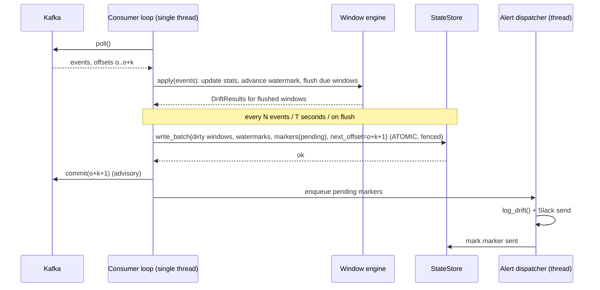

# Workflow 0 — etsi-watchdog Streaming (Kafka)
### Architecture decision record **and** delivery workflow — single self-contained document

> **How to use this file.** It is the *only* document an engineer needs, plus read access to the repository. The Watchdog Task Plan, the three candidate proposals that were evaluated, and every verification result are digested or embedded below. Nothing here says "see another file".
> **Intended path:** `docs/WORKFLOW_0.md`. Part II is the ADR; if maintainers prefer the usual layout, split Part II into `docs/adr/0001-streaming-architecture.md` and keep the rest here.
> **Baseline:** `etsi-ai/etsi-watchdog`, branch `main` (originally verified at `82bc76b`; `main` subsequently advanced to `e467479` with PRs #47 and #48 merging M1 and reservoir stats), package v3.0.0. Appendix A/B numbers below are from the `82bc76b` verification run.
> **Status:** Ratified by maintainer. All decisions ratified in §2.
> **Rule:** no Workstream 1–8 code starts before the Gate (§20) is green.

**Evidence tags used throughout**

| Tag | Meaning |
|---|---|
| **[V]** | Verified on 2026-10-03 against commit `82bc76b`, either by reading the cited source or by running a script from Appendix B |
| **[T]** | A target or assumption that still has to be measured; do not treat as a fact |

**Reading guide**

| If you are… | Read |
|---|---|
| A maintainer ratifying the design | Part I (§1–5), Part II (§6–9), §20 |
| The engineer implementing it | Part II, Part III, Part IV (§11–19), then §20–23 |
| Reviewing a PR | The decision(s) the PR cites (D-n), the PR's section in Part IV, §17 |

**Contents**

- **Part I — Context and decision:** 1 Objective · 2 Decisions on open items · 3 Task Plan digest · 4 Candidate proposals evaluated · 5 Repository constraints
- **Part II — Architecture decisions:** 6 D-1…D-12 · 7 Composition and layout · 8 Error characteristics · 9 Implications for Workstreams 1–8
- **Part III — Shared specifications:** 10 Event contract · StreamingStat contract · EventSource contract · health line
- **Part IV — Delivery workflow:** 11 Conventions · 12 Phase 0 · 13 M1 · 14 M2 · 15 M3 · 16 M4 · 17 Test matrix · 18 Plan traceability · 19 Claude Code prompts
- **Part V — Governance:** 20 Gate and acceptance · 21 Risks · 22 Re-litigation rules · 23 Follow-up tickets
- **Appendix A** verification evidence · **Appendix B** reproduction scripts

---

# PART I — CONTEXT AND DECISION

## 1. Objective and scope

Workflow 0 closes the Plan's Workstream 0 (Tasks 0.1–0.5) **and** the two decisions the Plan assigns to it implicitly: the checkpoint-then-commit sequence diagram (Task 3.2) and the lateness policy (Task 2.3). Output: one binding decision record so Workstreams 1–8 never revise architecture mid-sprint.

Part II fixes the interfaces, invariants and decisions; Part III the shared contracts; Part IV breaks delivery into PR-sized tasks (M1–M4) with files, algorithms, tests and acceptance checks.

## 2. Decisions on previously open items (final)

| # | Item | Decision |
|---|---|---|
| J1 | Time model | Event-time only; 30 s grace; late events dropped and counted |
| J2 | Alert delivery | At-least-once with one documented residual duplicate window (D-6) |
| J3 | Reservoir default | 2,000 (max 10,000) |
| J4 | Streaming KS threshold default | 0.95 (batch default 0.2 stays untouched) |
| J5 | Docker base image | `python:3.11-slim` despite `requires-python >=3.8` |
| J6 | `window_size_events` | Deferred out of v1 |
| Q1 | Topology | Producer key = `stream_id`; one stream → one partition; several streams may share a partition |
| Q2 | Redis owner lease | Mandatory for every non-memory backend |
| Q3 | Kafka retention floor | ≥ `max tolerated outage + CHECKPOINT_SECONDS + margin`; document ≥ 7 days as the operational default |

### 2.1 Ratification record (Gate W0.2)
- **Ratification Date:** 2026-11-20
- **Status:** Maintainer-ratified without overrides
- **Ratified Decisions:**
  - **J1 (Time model):** Confirmed — Event-time only; 30 s grace; late events dropped and counted.
  - **J2 (Alert delivery):** Confirmed — At-least-once with one documented residual duplicate window (D-6).
  - **J3 (Reservoir default):** Confirmed — 2,000 (max 10,000).
  - **J4 (Streaming KS threshold default):** Confirmed — 0.95 (batch default 0.2 stays untouched).
  - **J5 (Docker base image):** Confirmed — `python:3.11-slim`.
  - **J6 (`window_size_events`):** Confirmed — Deferred out of v1.
  - **Q1 (Topology):** Confirmed — Producer key = `stream_id`; one stream -> one partition; several streams may share a partition.
  - **Q2 (Redis owner lease):** Confirmed — Mandatory for every non-memory backend.
  - **Q3 (Kafka retention floor):** Confirmed — >= max tolerated outage + CHECKPOINT_SECONDS + margin; operational default >= 7 days.

## 3. Task Plan digest — what has to be built

The Watchdog Task Plan is the source of truth for scope and sequencing. This is its content, so the PDF is not needed.

### 3.1 The Plan's grounding facts about the repo

`DriftCheck` pulls a registered function by name and calls it with full `reference_df`/`current_df` (reusable pattern, not reusable implementation) · `drift/psi.py`, `ks.py`, `wasserstein.py` each run `np.histogram` / `scipy.stats.ks_2samp` / `scipy.stats.wasserstein_distance` over full arrays — none are incremental, so there is no streaming reuse without a rewrite · `drift/base.py::DriftResult` (score, threshold, details, `.summary()`, `.to_json()`) is fine to reuse · `Monitor` orchestrates `DriftCheck` + logging + Slack, all synchronous and pandas-based; `watch_rolling()` groups a DataFrame by `pd.Grouper(freq=…)` — "rolling over a static DataFrame", not a live window engine · no async, no Kafka, no Redis/RocksDB, no Dockerfile/compose; `requirements.txt` = numpy/pandas/scipy only. **Net: greenfield inside the repo — do not scope it as "add a consumer.py".**

### 3.2 Tasks

| Task | Requirement |
|---|---|
| **0.1** Stats approach | PSI is easy to make incremental (running binned counts). KS and Wasserstein are not cheaply incremental: choose (a) bounded reservoir sample recomputed at each flush, or (b) a quantile sketch (t-digest/KLL). Recommended: reservoir for v1, sketch as a follow-up. Output: ADR in `docs/`. |
| **0.2** Reference model | Static reference loaded once at start vs a streaming/updating one. The outcomes doc implies static reference + streaming current window; confirm explicitly. Output: one ADR paragraph + how the reference is loaded (env var path, S3, …). |
| **0.3** Redis vs RocksDB | Decide once, globally. Redis: separate container, network hop, trivial multi-instance sharing, native TTL, named in the compose spec. RocksDB: embedded, faster, pinned to one instance's disk, no native TTL. Recommended: Redis default, RocksDB as an optional pluggable backend. |
| **0.4** Message schema | Plain JSON vs Avro + Schema Registry. Recommended: JSON v1, Avro as a v2 hardening item. |
| **0.5** Partitioning | Simplest correct v1: single Kafka partition per monitored stream, single consumer instance, no cross-partition state merge; state keys still partition-aware; no rebalance-safe multi-partition support in v1 (see 3.4). |
| **1.1** Streaming PSI | New module (e.g. `streaming/stats/psi_incremental.py`). Fix bin edges from the reference once; keep a counts array incremented per event via `searchsorted`/`bisect` (O(1)); at flush use the same formula as `compute_psi` fed from running counts; must return a `DriftResult` identical in shape to batch so Slack/logging don't care. |
| **1.2** KS / Wasserstein | Per 0.1: bounded reservoir (e.g. 2,000 points, Algorithm R) or sketch, updated per event; at flush run `ks_2samp`/`wasserstein_distance` against the reference sample — same output contract as batch. Document approximation error characteristics in the docstring ("this will get asked about in review"). |
| **1.3** Registry | Register new algorithm names (e.g. `psi_streaming`, `ks_streaming`) via the existing `register_drift_algorithm()` — no parallel registry. |
| **2.1** Tumbling window | Fixed-size non-overlapping window (`window_size_seconds` or `window_size_events`); one active window of incremental stats per `(stream_id, feature)`; at the boundary flush → compute drift → reset. Build and ship first. |
| **2.2** Hopping window | Overlapping windows (`window_size > hop_size`). Correct approach: sub-bucket aggregation — buckets of `gcd(window_size, hop_size)`, incremental stats per bucket, combine the last `window_size/bucket_size` buckets each hop. Stat objects must be mergeable (counts add; reservoir needs weighted merge, not concatenation). Highest-uncertainty task: timebox a spike before estimating. |
| **2.3** Window keys + expiry | State keyed by `(stream_id, feature, window_start_ts)`. Define a lateness/grace period and pick one policy for late events (drop or "late" bucket) and document it. Old keys need TTL/cleanup (ties to Redis TTL). |
| **3.1** Consumer loop | New `streaming/kafka_consumer.py` using `confluent-kafka`; consumer group config; JSON deserialization per 0.4; dispatch each event to the right `(stream_id, feature)` window; **`enable.auto.commit=False`** — commits tied to successful state checkpointing. |
| **3.2** Checkpoint-then-commit | After N events or T seconds persist window state to the state store, then commit the offset. Crash in between ⇒ restart reprocesses from the last committed offset and rebuilds state (at-least-once, no silent state loss). Write the explicit sequence diagram in the ADR; commit-then-persist loses data. |
| **3.3** Startup rehydration | On start, for each assigned partition load unflushed window state and flush windows past their deadline immediately, then resume from the committed offset. Without it, partial-window aggregates are silently lost. |
| **3.4** Rebalance safety (stretch/v2) | `on_revoke`/`on_assign` persist and reload state around rebalances. Out of scope for v1; ticket it so it isn't skipped. |
| **3.5** Poison messages | Malformed JSON, missing features, wrong types: dead-letter topic vs drop-and-log. Existing convention (`drift_check.py`) is skip-and-print; mirror it but add a counter so it is not silent. |
| **4.1** StateStore ABC | `get/set/delete/list-by-prefix/expire` in `streaming/state/base.py`; Redis and RocksDB interchangeable. |
| **4.2** Redis store | `redis_store.py` with redis-py; serialise counts/reservoir/metadata (JSON or msgpack); use Redis TTL for expiry per 2.3's grace period. |
| **4.3** RocksDB store | `rocksdb_store.py` (python-rocksdb or rocksdict); same interface; no native TTL → manual cleanup pass. |
| **4.4** Serialization | One format; msgpack recommended for reservoir-heavy payloads; version it (`{"schema_version": 1, …}`). |
| **5.1** `StreamingMonitor` | `streaming/streaming_monitor.py`, structurally parallel to `Monitor`: consumer → window engine → drift → `DriftResult` → existing `log_drift()` and `SlackNotifier` (reuse outright). Config from env vars matching the `SLACK_BOT_TOKEN` convention. |
| **5.2** CLI | `python -m etsi.watchdog.streaming` and/or an `etsi-watchdog-stream` console script; env-driven; Docker entrypoint. |
| **6.1** Dockerfile | Slim Python image matching `requires-python`; install via the new extra; entrypoint = 5.2. |
| **6.2** docker-compose | zookeeper, kafka (as specified; flag KRaft as a simpler alternative), redis with `appendonly yes`, `watchdog-streaming` depending on the others with healthchecks; topic auto-create/init step so `docker compose up` is one command to a working demo. |
| **6.3** Packaging | `confluent-kafka`, `redis` (optionally `python-rocksdb`) as a `[project.optional-dependencies]` extra, e.g. `pip install etsi-watchdog[streaming]`. |
| **7.1** Window tests | `tests/test_streaming_window.py`: tumbling boundary correctness; hopping sub-bucket combination (where the bugs will be). |
| **7.2** Stats tests | Streaming PSI matches batch within tolerance (incremental vs all-at-once); KS/Wasserstein within a documented error bound, not identical. |
| **7.3** Fault-tolerance integration (**required**) | docker-compose or testcontainers: synthetic stream with known drift injected partway; kill the service mid-window; restart; assert **(a)** no duplicate drift alerts, **(b)** the drift is still detected, **(c)** Kafka offsets and Redis state agree. |
| **7.4** Benchmark | Mirror `examples/benchmark_drift_metrics.py`: sustained events/s of consumer + window + state; confirm Redis round-trip isn't the bottleneck before calling it production-ready. |
| **8.1–8.3** Docs | `docs/streaming.md` (architecture diagram, config reference, the ADR decisions) · `examples/streaming_demo.py` (Kafka producer replaying a CSV as a live stream, in the style of `examples/slack_integration_demo.py`) · README "Streaming (Kafka)" section with the `docker compose up` one-liner. |

### 3.3 Milestones

**M1** prove the pipeline — tumbling window only, in-memory state (no Redis), single consumer, streaming PSI only; goal: raw events → drift alert, end to end. **M2** fault tolerance — Redis state store, checkpoint-then-commit, startup rehydration; goal: pass Task 7.3. **M3** feature-complete — hopping windows, KS/Wasserstein approximations, RocksDB alternative. **M4** ship — compose packaging, load test, docs. Hopping (2.2) must not block M1/M2.

## 4. Candidate proposals evaluated

Three documents were supplied. Their content is digested in 4.1 so the originals are not needed; 4.2–4.7 is the evaluation and the decision.

### 4.1 What each candidate says

*("ADR" = architecture decision record, the Plan's term for the Workstream 0 output.)*

**Candidate 1 — DOCX "Workstream 0 — Architecture Decisions" (another developer).** A decision record covering Tasks 0.1–0.5 with options and reasons.
- *Grounding:* restates the Plan's repo facts and concludes "greenfield".
- *0.1:* options A reservoir (chosen, 2,000–5,000 points, then the batch scipy functions), B quantile sketches, C full bounded raw buffer, D research-grade online algorithms; **PSI as a true running histogram**; sketches later.
- *0.2:* static reference chosen; loaded via env var `REFERENCE_DATA_PATH` pointing to a local file **or an S3 URI**; not stored in Redis.
- *0.3:* comparison table Redis vs RocksDB; Redis default; abstract `StateStore` so both swap; claims "multi-instance sharing is free".
- *0.4:* plain JSON, example `{"stream_id": "model_v3_prod", "feature_a": 1.23, "feature_b": 45.6, "event_ts": 1724500000.123}`; Avro later.
- *0.5:* single consumer; "treat partitions independently (or one partition per monitored stream)"; partition-aware keys; rebalance safety out of scope.
- *Locked-decisions table* (PSI histogram; reservoir; static reference; Redis + optional RocksDB; JSON; single consumer) and **six "critical insights"**: greenfield; hopping is highest risk and must not block M1/M2; checkpoint-then-commit is mandatory; startup rehydration is mandatory; reuse the plug-in registry; downstream stays unaware of batch vs streaming.
- *Tech stack:* confluent-kafka, Redis, custom tumbling + hopping engine, JSON now → Avro later, docker-compose. Next steps: obtain team sign-off, then code Workstream 1 (PSI) and 2.1.

**Candidate 2 — `STREAMING_ADR.md` (the requester's own).** Status "Proposed for maintainer ratification"; five decisions with options / decision / why / consequences / revisit triggers.
- **D-1** reservoir sampling, **capacity 10,000** per `stream × feature × window`; exact KS/Wasserstein from scipy on the retained samples; sketches rejected for v1 (no tail-accuracy need, extra dependency, merge semantics).
- **D-2** static reference loaded once from `WATCHDOG_REFERENCE_PATH` (local CSV/Parquet); boot-time schema validation; no automatic re-baselining; runbook mitigation.
- **D-3** Redis default behind an abstract `StateStore`; RocksDB later; key `{consumer_group}|{stream_id}|{feature}|{window_start_ts}`; pipelining and coarse per-window blobs.
- **D-4** flat JSON with top-level `stream_id`, ISO-8601 `event_ts`, one numeric key per feature; reserved optional `schema_v`; "strict consumer-side validation (fail fast on missing/non-numeric features, reject unparseable timestamps)".
- **D-5** each monitored stream = exactly one Kafka partition, single consumer instance; designed-in (not built) scale-out by sharding streams across partitions.
- Composition diagram and a re-litigation table. Claims that reservoir merging is "irrelevant while D-5 keeps one owner" and that "same reference + same replayed stream ⇒ same scores".

**Candidate 3 — `WORKFLOW_0_STREAMING_GENERATOR.md` (the requester's own).** Its own banner: the Plan's actual Workstream 0 is five architecture decisions, *not* a data generator; this document specifies a supporting utility feeding Task 7.3 (synthetic stream with known drift) and Task 8.2 (CSV-replay producer).
- *Goal:* reproducible synthetic telemetry (one seed ⇒ byte-identical anomalies). Non-goals: not Workstream 0, not fuzzing, not distributed.
- *Architecture:* new `etsi/watchdog/datagen/` package (~14 modules: generator, sources, signals, scenarios, clock, config, cli, sinks for stdout/Kafka/**MQTT/WebSocket**), a transport registry, a bounded backpressure queue, YAML + CLI config, an **NGSI-LD** adapter (merge-patch/deadband), a `[datagen]` extra (+ `paho-mqtt`, `websockets`, `pyyaml`), a second console script, soak test, six-PR build order. Two source modes: synthetic and CSV replay.
- *Constraints C1–C8 against the existing batch APIs* (all kept): C1 numeric `float64`/`int64` only (PSI refuses non-numeric; bools fail) · C2 no `±inf`/all-NaN windows (one `inf` poisons PSI's bin edges) · C3 monotonic unique timestamps per stream · C4 ≥ 50 rows per aggregation bucket · C5 RFC 3339 UTC event time on every record · C6 stable, exactly-matching feature names · C7 `IsolationForestModel` needs a `(1, n_features)` row frame, no partial fit · C8 anomaly score orientation (`decision_function`: negative = more anomalous) vs `DriftResult.is_drifted` (`score > threshold`).
- *Threshold semantics:* PSI ≈ effect size, 0.2 classic cutoff, vacated bins under-report; KS score = `1 − p`, so the shared 0.2 fires whenever `p < 0.8` → use ~0.95+; Wasserstein is in raw feature units.
- *Scenarios:* `level_shift`, `gradual_drift`, `variance_burst` and others, injected at controlled offsets.

### 4.2 DOCX proposal — analysis

A decision record, not a design. It covers the five decisions with rejected alternatives and a stack table; most requested axes (state lifecycle, failure semantics, concurrency, testing, migration) are **absent**, not wrong.

| Axis | What it provides | Assessment |
|---|---|---|
| 0.1 | Reservoir for KS/W; **PSI as exact running histogram**; rejects bounded raw buffer and research online algorithms | Strong — records PSI (Candidate 2 omits it) and two extra rejected options. Size "2,000–5,000" is a range, not a decision |
| 0.2 | Static reference; `REFERENCE_DATA_PATH` file **or S3 URI** | S3 adds a dependency and remote-failure modes in v1; unsupported by repo |
| 0.3 | Redis default, pluggable RocksDB, `StateStore` ABC | Sound. **"Multi-instance sharing is free" is false** for window state: a shared Redis does not give safe concurrent writers; it also contradicts its own 0.5 section and Plan 3.4 |
| 0.4 | JSON; example uses epoch-float `event_ts` | Unit (s vs ms) and timezone unspecified |
| 0.5 | "Treat partitions independently **(or** one partition per stream)" | A hedge, not a decision |
| Process | Calls decisions "Locked" yet asks for sign-off; delivered as `.docx` | Plan wants the ADR in `docs/`; `.docx` can't be reviewed in a PR |
| Gaps | No sequence diagram (3.2), no lateness policy, no registry-signature, PSI-edge-parity, alert-idempotency, or offset/state-atomicity treatment | See 4.8 |

Retain: PSI-as-histogram decision, extra rejected options, "critical insights" list, milestone gating. Reject: S3 in v1, "multi-instance is free", epoch-float example, hedged 0.5, `.docx` as the record.

### 4.3 `STREAMING_ADR.md` — analysis

**Strengths:** precise per-decision structure (options/decision/why/consequences/revisit); ISO-8601 schema example; key layout; re-litigation table; Python 3.8 awareness; composition diagram; reuses scipy; correct plan alignment on D-2/D-3/D-4.
**Defects:**

| # | Defect | Evidence |
|---|---|---|
| A1 | "Reservoir merging irrelevant while single owner" — **wrong**; hopping (Task 2.2) merges sub-buckets on one instance | plan 2.2; revisit trigger omits hopping |
| A2 | Capacity 10,000 vs plan's 2,000 | 201 KB JSON/78 KB raw per feature-window; ~48 MB per checkpoint at 100×6; KS median 0.93 → 1.00 for a 0.05σ shift (n 2k → 10k) [V] |
| A3 | Determinism claim ("same stream ⇒ same scores") false with an unseeded reservoir | Algorithm R is random |
| A4 | PSI not mentioned in D-1; no edge/out-of-range policy | R2, R3 |
| A5 | Key uses `\|` delimiter and calls itself "partition-aware" though it embeds no partition | stream_id is untrusted input |
| A6 | D-4 "fail fast on missing/non-numeric" is ambiguous — crash-looping on one bad message | plan 3.5 wants skip + counter |
| A7 | D-5 "one partition per stream" has no mechanism (key hashing can't guarantee it) and is stronger than correctness needs | — |
| A8 | No checkpoint sequence diagram (mandated), no lateness policy | plan 3.2, 2.3 |
| A9 | "Thresholds are calibrated empirically" — unsupported; repo uses a global `0.2` | R4 |
| A10 | Not in `docs/`; status "Proposed" with no ratification step | plan 0.1 |

### 4.4 Generator proposal — analysis

Its own banner: *"the plan's actual Workstream 0 is five architecture decisions… not a data generator."* Evaluated as what it is — a supporting utility for Tasks 7.3 and 8.2:

- **Plan asks:** a synthetic stream with injected drift (7.3) and `examples/streaming_demo.py`, a Kafka producer replaying a CSV (8.2).
- **Doc delivers:** a new `datagen/` package (~14 modules), 4 transports (stdout, Kafka, **MQTT, WebSocket**), an **NGSI-LD** adapter with merge-patch/deadband, YAML config, an asyncio backpressure framework, a `[datagen]` extra (+`paho-mqtt`, `websockets`, `pyyaml`), a second console script, a soak test, six PR milestones. Roughly an order of magnitude beyond the plan, with three requirements nobody stated.
- **Worth keeping (verified):** seeded determinism; scenario shapes `level_shift`/`gradual_drift`/`variance_burst`; the per-algorithm threshold insight (KS needs ~0.95 — confirmed by Appendix B.1); constraints C1–C8 (spot-checked C4/C8 against `monitor.py`/`isolation_forest.py` — accurate); keeping `streaming/` namespace free; stable feature sets.
- **Problems:** asyncio design conflicts with the repo's sync idiom and the plan's sync consumer; "single-partition topics … key = stream_id" is ambiguous (one topic per stream, or key-hash?); none of it addresses checkpointing, which is where Task 7.3's actual risk sits.

### 4.5 Side-by-side technical comparison

| Criterion | DOCX | `STREAMING_ADR` | Generator doc |
|---|---|---|---|
| Plan compliance | High (near 1:1 restatement); misses 3.2 diagram, 2.3 | High on 0.2–0.4; misses 3.2 diagram, 2.3 | **Off-plan** (not Workstream 0) |
| Codebase compatibility | Doesn't engage registry signature, `log_drift`, eager `__init__` | Better (3.8 floor, extras, no `run_cli` change) but misses R1/R3/R6 | Strong on batch APIs (C1–C8); wrong layer |
| Architectural consistency | Hedged D-5; false multi-instance claim | Coherent; merge error (A1) | Sync repo vs asyncio design |
| Correctness | PSI/KS right; no replay-safety | Replay double-count and determinism gaps | n/a |
| Complexity | Low | Low–medium | **Very high** |
| Maintainability / extensibility | OK; StateStore ABC | Better (revisit triggers) | Large surface to maintain |
| Perf / resources | Size "2–5k" undecided | 10k reservoir → heavy checkpoints | Soak test, queue policy (irrelevant to service) |
| Reliability / failure handling | Mentions both mandatory patterns, no mechanism | Same; "fail fast" ambiguity | Sink reconnect only |
| Concurrency | Absent | Absent | asyncio sinks only |
| Observability | Absent | Absent | Health line (good idiom, wrong component) |
| Testing complexity | Absent | Points to 7.3 only | Extensive but for the generator |
| Migration / back-compat / regression risk | Low | Low | Adds public exports + deps |
| Implementation effort | Minimal | Minimal | Large, off-critical-path |
| Unsupported assumptions | S3 loader; "multi-instance free"; epoch unit | "calibrated empirically"; 3.8 client availability (verify) | MQTT/WebSocket/NGSI-LD demand |

### 4.6 Decision: **C — Hybrid**

**C — Hybrid.** Base = `STREAMING_ADR.md`; merge DOCX parts; add the new decisions; shelve the generator into Workstream 8.

- **Not A:** the DOCX is thinner, contains one factually wrong claim (multi-instance), and hedges D-5.
- **Not B as-is:** sound skeleton, but A1/A2/A3/A6/A8 would each cause rework or a failed Task 7.3.
- **Not D:** neither approach is wrong at the architecture level; the five decisions stand. The problems are omissions and amendments, so a redesign isn't warranted.

### 4.7 Exact rationale

1. **Plan 3.2/7.3 demand replay-safe state, which neither doc provides.** A crash between "persist" and "commit" replays events already in the checkpoint → double counting. Fix: offsets inside the same atomic write; store is the source of truth (D-6). Without it, 7.3(c) "offsets and Redis state agree" is unprovable.
2. **Plan 7.3(a) "no duplicate alerts" needs idempotency**, which at-least-once delivery doesn't give. Fix: flushed-window marker in the checkpoint (D-8).
3. **Plan 1.2 / 2.2 require merge.** Candidate 2's claim that merging is irrelevant contradicts 2.2's own warning (D-1).
4. **Plan 1.1 says streaming PSI must match batch; R2 says it can't in general.** Measured (50k reference, 2,000-event windows): identical to 4 decimals at 0–0.5σ shift, diverging at large shifts (batch 6.65 / clamp 8.61 / drop-outside 6.53 at 4σ). So parity must be *defined* (exact in-range; same classification out-of-range) before 7.2 can be written.
5. **R4 + plan 1.2:** at the shared default threshold `0.2`, KS flags **82.6%** of null windows (7.6% at 0.95, 1.0% at 0.99) [V]. A streaming service evaluates many windows × features × streams; inheriting `0.2` would be an alert storm on day one.
6. **R1 + plan 1.3 ("don't fork a parallel registry"):** a streaming stat object cannot be registered as-is. Adapter + `stat_factory` attribute keeps one registry (D-10).
7. **R9:** importing any submodule requires `slack_sdk`; streaming deps must be lazy and extra-gated or batch users regress.
8. **R6/R7 + plan 5.1 "reuse outright":** reuse is right, but `log_drift` crashes on a bare filename and Slack is synchronous — both need handling at the integration boundary, not in `log_drift` itself (no changes to existing modules).
9. **Plan 3.5 vs Candidate 2's "fail fast":** a data error that crashes the consumer without advancing the offset loops forever.

### 4.8 What was taken, discarded and newly designed

**Take from Candidate 1 (DOCX):** PSI running-histogram decision; extra rejected options; critical-insights list; milestone gating.
**Take from Candidate 2 (`STREAMING_ADR.md`):** structure, schema, key layout (amended), revisit table, 3.8 awareness.
**Take from Candidate 3 (generator):** seeded determinism, scenario shapes, per-algorithm threshold insight, namespace discipline.
**Discard:** S3 in v1; "multi-instance free"; epoch-float example; hedged 0.5; `.docx` as the record; MQTT/WebSocket/NGSI-LD/YAML/asyncio sinks/`[datagen]`/second console script; the 10k default.

**Newly designed (all specified in Part II):**

| ID | Addition | Why it's here (not boilerplate) |
|---|---|---|
| D-1 amend | PSI edges/clamp/zero-rule; seeded checkpointed RNG; 2,000 default; `merge()` | R2, R3, A1–A4 |
| D-3 amend | `write_batch` atomic + `InMemoryStateStore`; safe key scheme; msgpack | D-6 needs atomicity; M1 needs in-memory |
| D-5 amend | Invariant restated; **Redis single-owner lease** | v1 safety depends on one instance |
| D-6 | Offsets in state, seek-from-state, **sequence diagram + crash table** | 3.2, 7.3 |
| D-7 | Epoch-aligned event-time windows, watermark, grace, **drop-late**, no idle flush in v1, `min_events`, events-based windows deferred | 2.3 |
| D-8 | Idempotency key, pending/sent markers, dispatcher thread, CSV logging | 7.3(a), R6, R7 |
| D-9 | Message vs feature vs boot validation; `MAX_STREAMS`; stream_id charset | 3.5; untrusted input |
| D-10 | Adapters + `stat_factory`; registration at streaming import; KS default 0.95; Wasserstein threshold required | 1.3, R1, R4 |
| D-11 | Env names, `-m`/script entry, extras, image base, security notes | 5.1–6.3 |
| D-12 | Single processing thread, `EventSource` seam, counters + health line, crash-matrix tests | 3.5, 7.3 |

## 5. Repository constraints that shape the design

| # | Fact | Consequence |
|---|---|---|
| R1 | Registry callables are `func(reference_df, current_df, feature, threshold)` over DataFrames **[V]** (`drift/factory.py`, `drift_check.py`) | `*_streaming` registrations are DataFrame adapters (D-10) |
| R2 | `compute_psi` derives bin edges from `concat(expected, actual)` min/max **[V]** | Streaming PSI (edges fixed from reference) differs outside the reference range (D-1) |
| R3 | PSI contributes 0 for any bin with 0% mass on either side **[V]** | Overflow bins would hide drift → clamp instead of adding bins |
| R4 | KS score is `1 − p`; shared default threshold `0.2` **[V]** | Flags ~83% of no-drift windows (Appendix A) → separate streaming default |
| R5 | `DriftResult(method, score, threshold, details, sample_size)`; `is_drifted` is strict `>`; `plot()` reads `details` keys **[V]** | Reuse as-is; extend only through `details` |
| R6 | `log_drift` stamps `datetime.now()`, has no stream/window fields, JSON mode rewrites the whole file, and **raises `FileNotFoundError` on a bare filename** **[V]** | Reuse with CSV and a path that has a directory; encode stream in `feature` |
| R7 | `SlackNotifier.__init__` makes a network `auth_test`; sends are synchronous; env `SLACK_BOT_TOKEN`/`SLACK_CHANNEL` **[V]** | Boot-time fail-fast; sends only from a dispatcher thread |
| R8 | `DriftHook.trigger_on_drift()` takes no arguments **[V]** | Cannot carry a result; not used |
| R9 | `etsi/watchdog/__init__.py` eagerly imports monitor → `slack_sdk`, sklearn, pandas; importing `drift.psi` alone fails without `slack_sdk` **[V]** | Lazy streaming imports; extras; do not edit `__init__` |
| R10 | `requires-python >=3.8`; no extras, scripts, `__main__`, CI, Dockerfile; `docs/` has one file; `etsi/` is a namespace package with **no** `__init__.py` **[V]** | Everything additive; new subpackages need their own `__init__.py` |
| R11 | Diagnostics are `print`-based; no `logging`, no async **[V]** | Counters + `print` health line; synchronous design |

**Touch:** `drift/factory.py` (via `register_drift_algorithm`), `drift/base.py` (`DriftResult`), `logger.py`, `slack_notifier.py`, `pyproject.toml`, `docs/`. **Never edit:** `__init__.py`, `monitor.py`, `cli.py`, the batch algorithms, `logger.py`, `slack_notifier.py`.

---

# PART II — ARCHITECTURE DECISIONS

## 6. Decisions

### D-1 · Streaming statistics (Task 0.1) — amended

**Decision.**
- **PSI:** exact running histogram. `edges = linspace(ref.min(), ref.max()+1e-8, buckets+1)` computed **once** from the reference; counts incremented with `bisect.bisect_right` on a Python list (≈2.1M events/s vs ≈0.43M for scalar `np.searchsorted` **[V]**). Out-of-range values **clamp into the first/last bin**. The batch zero-mass rule (`e == 0 or a == 0 → 0`) is mirrored exactly.
- **KS / Wasserstein:** fixed-capacity reservoir (Algorithm R), default **2,000**, configurable, hard max 10,000. Flush runs `scipy.stats.ks_2samp` / `wasserstein_distance` against a **reference sample subsampled once at boot** (seeded, `REFERENCE_MAX_SAMPLES` = 50,000).
- **Determinism:** reservoir RNG is **SplitMix64** with a single `uint64` state, seeded from `blake2b(base_seed | stream_id | feature | window_start)` and **checkpointed with the reservoir**. Not `numpy` PCG64 (state exceeds 64 bits → msgpack `OverflowError` **[V]**); never Python `hash()` (randomised per process **[V]**). A mid-stream checkpoint/restore reproduced the identical sample **[V]**; throughput ≈1.4M events/s **[V]**.
- **Merge:** every stat implements `merge()`. PSI merge = count addition (exact). Reservoir merge draws the per-side counts from a **hypergeometric** distribution weighted by `n_seen`. Naive concatenation of unequal-size reservoirs is wrong (KS vs union p≈0 **[V]**); hypergeometric merge passes (median p≈0.63, 7% < 0.05 **[V]**).
- **Stat contract:** `update`, `merge(other, rng_seed)`, `finalize(reference, threshold, meta) → DriftResult`, `to_state`, `from_state`, `reset`, `n`.

**Why 2,000 (not the draft's 10,000).** Payload per feature-window is ≈17.6 KB msgpack at 2k vs 201 KB JSON / 78 KB raw at 10k; at 100 streams × 6 features that is ≈48 MB rewritten per checkpoint at 10k **[V]**. Capacity is also a sensitivity knob: for a 0.05σ mean shift the median KS score is 0.93 at n=2,000 and 1.00 at n=10,000 **[V]** — documented, not treated as memory tuning only.

**Parity definition (testable).** Streaming PSI == batch `compute_psi` to `1e-9` when all current values lie in the reference range. Outside it the scores diverge by design (4σ shift: batch 6.65 vs clamp 8.61 **[V]**); the guarantee is then **same drifted/not-drifted classification**. KS/Wasserstein: within a documented error bound, never equality (§8).

**Rejected:** unbounded raw buffer (memory scales with window); research-grade online KS/Wasserstein (no production libraries); sketches (t-digest/KLL) → v2 ticket.
**Revisit when:** alerts depend on p99+ tail shape; multi-instance state merging is required.

### D-2 · Reference model (Task 0.2) — kept

Static reference loaded once from `WATCHDOG_REFERENCE_PATH` (local CSV/Parquet). **No S3/remote in v1** (new dependency + failure modes). Boot validates the artifact against `WATCHDOG_FEATURES` (present, numeric, non-empty) and fails fast. No automatic re-baselining (sustained drift would silently become the new normal); mitigation is a documented runbook: regenerate artifact → restart. Determinism ("same reference + same stream ⇒ same scores") holds because of D-1's seeded, checkpointed RNG.
**Revisit when:** product explicitly requests adaptive baselining and accepts the feedback risk.

### D-3 · State store (Task 0.3) — amended

Redis is the default; RocksDB is an optional backend behind the same `StateStore` ABC. Contract:

```python
get(key) -> Optional[bytes]
get_many(keys) -> Dict[str, bytes]
list_prefix(prefix) -> List[str]
write_batch(puts, deletes, ttl=None, fence=None) -> None   # ATOMIC; raises on failure or fence mismatch
close()
```

Implementations are **thread-safe** (the dispatcher writes `sent` markers). `InMemoryStateStore` (lock + `snapshot()/restore()`) is the M1 backend and the test double.

**Keys** (`stream_id` restricted to `^[A-Za-z0-9._-]{1,128}$`, rejected otherwise — it is untrusted input landing in a key; `|` delimiter dropped):

| Key | Value | TTL |
|---|---|---|
| `wd:v1:{g}:offset:{topic}:{partition}` | int `next_offset` | none |
| `wd:v1:{g}:wm:{stream_id}` | float watermark (epoch s) | none |
| `wd:v1:{g}:win:{stream_id}:{feature}:{start}` | `{schema_version, algo, stat_state}` | `window_size + grace + margin`, refreshed on write |
| `wd:v1:{g}:marker:{stream_id}:{feature}:{algo}:{start}` | `{schema_version, status: pending\|sent, result}` | 24 h from last write |
| `wd:v1:{g}:owner` | lease token | `LEASE_TTL_SECONDS` |

**Serialization:** msgpack with `schema_version` (Task 4.4); never pickle. All stored numbers cast to plain `float`/`int`.
**Redis operations:** `appendonly yes` **and `maxmemory-policy noeviction`** (an LRU policy could silently evict window state). The checkpoint is applied by a Lua script that first verifies the D-5 owner token, so a zombie instance cannot write. If Redis Cluster is ever used, wrap `{g}` in literal braces (hash tag) so a checkpoint's keys share one slot; v1 targets a single Redis. Because offsets are in the same atomic write as state (D-6), even a rollback to an older AOF point is self-consistent — it just replays more Kafka.
**Cost:** one round-trip per checkpoint, not per event.
**Revisit when:** measured state volume/latency hurts, or embedding becomes an ops win.

### D-4 · Message schema (Task 0.4) — kept, parsing rules added

Flat JSON; producer key = `stream_id`:

```json
{"stream_id": "station-007", "event_ts": "2026-08-26T14:00:00Z", "temperature": 23.4, "relativeHumidity": 61.2}
```

`event_ts`: ISO-8601 with `Z`/offset (naive rejected) **or** epoch seconds in `[0, 1e11)`. Python 3.8–3.10 `datetime.fromisoformat` rejects a trailing `Z` and fractions that are not 3 or 6 digits → normalise `Z` → `+00:00` and pad/truncate the fraction to 6 digits. Reserved optional `schema_v`. Validation semantics: D-9.
**Why JSON:** no registry to run (CI stays broker-free), human-debuggable, shortest path to M1. **Revisit when:** external producers appear, schema governance lands, or encoding cost is measurable.

### D-5 · Partitioning and ownership (Task 0.5) — amended

**Invariant:** all events of one `stream_id` go to **one partition** (producer key = `stream_id`) and exactly **one consumer instance** owns the group. Several streams may share a partition; checkpoints cover all windows of all streams on the assigned partitions. (The draft's "one partition per stream" was stronger than correctness needs and had no mechanism — key hashing cannot guarantee 1:1.)
**Single-owner guard:** at boot the service takes a Redis lease `SET owner <token> NX PX <ttl>`; the processing loop renews it whenever more than `ttl/3` has elapsed (renew only if the token matches); loss of the lease ⇒ stop immediately without writing. Boot waits up to `LEASE_TTL_SECONDS` for a dead owner's lease to expire, then fails with a clear message. Graceful shutdown releases it. v1's safety rests on "one instance"; this enforces it.
**Not in v1:** rebalance safety across multiple instances (Task 3.4, ticketed). **In v1:** `on_assign` seeks from stored offsets (required by D-6) and `on_revoke` triggers a checkpoint.
**Designed-in scale-out:** shard streams across partitions by key, run multiple consumers; state keys already embed `stream_id`, so ownership transfer needs no data migration.
**Revisit when:** aggregate load approaches single-consumer capacity.

### D-6 · Checkpoint, offsets and replay — new (the fault-tolerance core)

"Persist state, then commit offset" alone is **not** enough: a crash between the two replays events already contained in the checkpoint and double-counts them. Therefore:

1. A checkpoint is **one atomic `write_batch`** containing: dirty window states, per-stream watermarks, flushed-window markers, per-partition `next_offset`; flushed windows' state keys are deleted in the same batch.
2. **The state store is the source of truth for position.** On `on_assign`, seek to the stored `next_offset`; the Kafka commit is advisory (lag tooling, group continuity). No stored offset ⇒ fall back to committed/`earliest` and print that state was absent. If Kafka reports the stored offset out of range (retention expired) ⇒ `earliest`, `offset_resets += 1`, loud warning (state and log no longer line up).
3. Triggers: every `CHECKPOINT_EVENTS` (1,000) **or** `CHECKPOINT_SECONDS` (5), on every window flush, on `on_revoke`, on shutdown.
4. **Dispatch only after the durable write.** Nothing is committed or alerted without a checkpoint. If the store fails: `pause()`, retry with backoff for 60 s, then exit non-zero.



| Crash point | On restart | Outcome |
|---|---|---|
| after `apply`, before `write_batch` | seek to older stored offset, rebuild | no loss, no double count |
| after `write_batch`, before Kafka commit | **seek to stored `next_offset`** (ignore stale commit) | no double count |
| after commit, before dispatch | `pending` markers re-dispatched | alert delivered once |
| after Slack ack, before `sent` mark | `pending` re-dispatched | **one possible duplicate**, same idempotency key |
| *reversed order (commit, then persist)* | events `o..o+k` gone | silent loss — **never do this** |

**Rehydration (Task 3.3)** = load all `win:*`/`wm:*` → sweep `flush_due` (idempotent safety net; in the event-time model all due windows were already flushed in-line) → re-dispatch `pending` markers → seek from stored offsets.
**Shutdown (SIGTERM):** stop polling → finish batch → final checkpoint → commit → drain dispatcher (≤ 10 s) → release lease → exit 0.
**Never reorder.** Amend only with a new crash matrix.

### D-7 · Windows, time, lateness (Tasks 2.1–2.3) — new

- **Event time** = `event_ts`. Tumbling windows are **epoch-aligned**: `start = floor(ts/size)*size`, identical across restarts and replays.
- **Per-stream watermark** = max accepted `event_ts` (monotonic, checkpointed). A window flushes when `watermark ≥ start + size + grace` (`GRACE_SECONDS` = 30). Several windows per `(stream, feature)` may be open at once.
- **Late** = event whose window already flushed (`start + size + grace ≤ watermark` before this event). **Dropped and counted** (`late_dropped`). One policy, no late bucket in v1.
- **No wall-clock flush in v1**: a silent stream's last window stays open (reported as `streams_idle`). Optional `max_idle_flush_seconds` (default off) because it introduces nondeterminism. Tests send a trailing event to close the final window.
- `min_events_per_window` = 50 (mirrors the batch `<50` warning): smaller windows emit no result, only a counter.
- **Deferred:** `window_size_events` (key scheme is time-based).
- **Hopping (M3):** sub-buckets of `gcd(size, hop)`, merged through the stat `merge()`; flush at `watermark ≥ s + W + grace`; buckets retired once every window containing them is flushed; idempotency key uses the window start. **Timeboxed spike before any estimate**; fallback if the spike justifies it for small `W/H`: multi-assign each event to its overlapping windows. Never gates M1/M2.
- Flushed windows are deleted; markers keep a 24 h TTL.
**Revisit when:** a consumer needs processing-time or count-based windows.

### D-8 · Alert semantics and delivery — new

- **Idempotency key** = `(stream_id, feature, window_start, algorithm)`; a flush writes its marker and `DriftResult` inside the checkpoint, so a replayed flush finds the marker and does not re-emit.
- **Delivery: at-least-once** with the one residual duplicate in D-6. Exactly-once to Slack is not achievable.
- `log_drift` for **every** flushed result (as `Monitor.watch` does); Slack only when `is_drifted`. CSV only (JSON mode is O(n) per write), path with a directory component. Stream identity is encoded as `feature=f"{stream_id}/{feature}"`; `additional_context` carries `stream_id`, `window_start`, `window_end`, `n_events`, idempotency key. A backward-compatible `extra=` kwarg on `log_drift` is a separate ticket.
- Sends run on **one dispatcher thread** behind a bounded queue (1,000); the poll loop never calls Slack, so `max.poll.interval.ms` is safe. Failure ⇒ exponential backoff (1 s → 30 s, 5 tries) ⇒ `alerts_failed`; marker stays `pending`; pending markers are re-dispatched every 60 s and on boot.
- Stats/state objects are never shared across threads; the loop hands over immutable `DriftResult`s.
**Revisit when:** a downstream sink offers idempotent delivery.

### D-9 · Validation and poison messages (Task 3.5) — new

- **Message level** — unparseable JSON, missing/invalid `stream_id`, bad `event_ts`, `ts_future`, `stream_cap`: drop, count by reason, **offset still advances** (a poison message must never wedge the partition).
- **Feature level** — missing, non-numeric (bool excluded), NaN, ±inf: skip *that feature for that event* (mirrors batch `dropna()`), count by reason.
- **Fail fast only at boot** (reference, config, Redis, Slack auth, `LOG_PATH`), never on data.
- **Watermark-poisoning guard:** one far-future `event_ts` would advance a stream's watermark, flush every open window early, and turn all later genuine events "late". Events with `event_ts > wall_clock + MAX_FUTURE_SKEW_SECONDS` (3600; `0` disables) are rejected as `ts_future` and never touch the watermark. Known edge: this reads wall-clock time, so an event rejected before a crash could be accepted on replay once it ages into range — documented, not engineered away.
- `MAX_STREAMS` (1,000): new `stream_id`s beyond the cap are dropped and counted — total state is `streams × features × reservoir`, not "constant".
- DLQ topic: v2.

### D-10 · Registry integration and thresholds (Task 1.3) — new

- Register `psi_streaming`, `ks_streaming`, `wasserstein_streaming` through the **existing** `register_drift_algorithm` (no parallel registry). Each registered callable is a **DataFrame-signature adapter** (replays `current_df` through the incremental object, then `finalize`), so `DriftCheck`, `Monitor` and the CLI accept it and the adapter doubles as the parity-test harness. The service reads the incremental class from the same entry (`.stat_factory`, `.default_threshold`).
- Registration happens when `etsi.watchdog.streaming` is imported, **not** at `etsi.watchdog` import (the registry prints on each registration; batch users see no change).
- `DriftResult`: `method` = `"psi"|"ks"|"wasserstein"` (unchanged strings); `sample_size` = events in the window; `details` keeps the batch keys (PSI: `bins`, `expected_percents`, `actual_percents`, `psi_per_bin`; KS: `ks_statistic`, `p_value`; W: `wasserstein_distance`) and adds `window_start`, `window_end`, `n_events`, and for sketches `n_seen`, `reservoir_size`, `approximation`, `dkw_epsilon_95`.
- **Defaults:** PSI 0.2; **KS 0.95** (not 0.2: no-drift false-alert rate 82.6% at 0.2, 7.6% at 0.95, 1.0% at 0.99 **[V]**); **Wasserstein threshold required** (score is in raw feature units).

### D-11 · Configuration, entrypoint, packaging (Tasks 5.1, 5.2, 6.1, 6.3) — new

Env-driven `StreamingConfig.from_env()` with `validate()`. Slack keeps `SLACK_BOT_TOKEN`/`SLACK_CHANNEL`; all new variables use `WATCHDOG_`:

| Variable | Default |
|---|---|
| `KAFKA_BOOTSTRAP`, `TOPIC` (required), `GROUP` | `etsi-watchdog` |
| `REFERENCE_PATH`, `FEATURES` (comma list) | required |
| `ALGORITHM`, `THRESHOLD`, `PSI_BUCKETS` | `psi_streaming`, per-algo default, 10 |
| `WINDOW_TYPE`, `WINDOW_SECONDS`, `HOP_SECONDS` | `tumbling`, required, – |
| `GRACE_SECONDS`, `MIN_EVENTS` | 30, 50 |
| `RESERVOIR_SIZE`, `REFERENCE_MAX_SAMPLES`, `SEED` | 2000 (max 10000), 50000, 0 |
| `STATE_BACKEND`, `STATE_URL` | `memory`, – (`redis://`/`rediss://`) |
| `CHECKPOINT_EVENTS`, `CHECKPOINT_SECONDS` | 1000, 5 |
| `LEASE_TTL_SECONDS` | 30 (10 in tests) |
| `MAX_STREAMS`, `MAX_FUTURE_SKEW_SECONDS` | 1000, 3600 |
| `LOG_PATH`, `HEALTH_SECONDS` | must contain a directory, 60 |

Boot fails fast on: missing required vars; feature absent or non-numeric; empty reference; reservoir > 10,000; hopping without `hop` or `window % gcd ≠ 0`; Wasserstein without threshold; `LOG_PATH` without a directory.
**Entry:** `python -m etsi.watchdog.streaming` + console script `etsi-watchdog-stream` (additive `[project.scripts]`; `run_cli()` untouched).
**Extras:** `streaming = [confluent-kafka, redis, msgpack]`; `streaming-rocksdb = [rocksdict]` (native build, separate). All imports lazy with an actionable `ImportError`. Dependency floors on Python 3.8 verified in CI before any code (Gate).
**Docker:** `python:3.11-slim`, non-root, full core deps (R9). **Security:** Redis auth/TLS via URL; no secrets in compose files; no pickle; stream-id charset rule.

### D-12 · Concurrency, structure, observability — new

- **One** processing thread (consume → validate → update → flush → checkpoint → lease renewal); **one** dispatcher thread. No asyncio.
- Kafka I/O behind an `EventSource` ABC (`start`, `poll`, `commit`, `pause/resume`, `close`) so windows/stats/checkpoint run broker-free in unit tests; `FakeEventSource` replays a message list and tracks committed offsets.
- **Metrics:** plain counters + periodic `print` health line: `events_in`, `events_rejected{reason}`, `features_skipped{reason}`, `late_dropped`, `windows_flushed`, `windows_skipped_insufficient`, `checkpoints`, `checkpoint_ms_last`, `checkpoint_bytes_last`, `alerts_sent/failed/pending`, `offset_resets`, `streams_active`, `streams_idle`, `lag_events`. Prometheus is v2.
- **Tests:** a unit-level **crash matrix** (fault hooks after each D-6 step, `InMemoryStateStore` + `FakeEventSource`) runs **before** Redis and again on Redis, in addition to Task 7.3's Docker kill-and-restart.

## 7. How the decisions compose, and the package layout

```
Producers ──key=stream_id──▶ Kafka (stream → one partition)          single owner (D-5 lease)
   └▶ EventSource ─▶ validate/dispatch (D-4, D-9)
        └▶ window engine: epoch-aligned, watermark, grace (D-7)
             └▶ stats: PSI histogram | seeded reservoir (D-1) vs static reference (D-2)
                  └▶ flush → DriftResult (D-10)
                       └▶ ATOMIC checkpoint {state, watermarks, markers, offsets} → StateStore (D-3, D-6)
                            └▶ Kafka commit (advisory) → dispatcher thread → log_drift + SlackNotifier → mark sent (D-8)
```

Target package layout (all new, additive): `etsi/watchdog/streaming/{__init__, __main__, config, events, metrics, source, kafka_consumer, checkpoint, alerts, streaming_monitor}.py`, `stats/{base, rng, reference, psi_incremental, reservoir, ks_streaming, wasserstein_streaming, adapters}.py`, `windows/{keys, engine, tumbling, hopping}.py`, `state/{base, codec, memory_store, redis_store, rocksdb_store, lease}.py`; tests in `tests/streaming/`.

## 8. Error characteristics to document (Task 1.2)

- **KS (reservoir):** with 95% confidence the KS *statistic* differs from the full-window value by at most ε_cur + ε_ref, ε = √(ln(2/0.05)/(2k)): **0.030** for k = 2,000, **0.0136** for k = 10,000, ≈ **0.006** for the 50,000-sample reference. The p-value is computed from the reservoir size, not `n_seen`, so it is more conservative than a full-window KS.
- **Wasserstein:** no distribution-free bound; bounded empirically in tests (relative error on bounded features).
- **PSI:** exact in-range; clamped outside (D-1).
- **No-drift alert rate** at the KS default 0.95 is ≈5–8% per window by construction **[V: 7.6%]** — documented, not "fixed".

## 9. Implications for Workstreams 1–8 and milestone sequencing

| WS | Change from the Plan as written |
|---|---|
| 1 | Stat contract with `merge`/`to_state`/`from_state`; PSI clamp + zero-rule; SplitMix64 reservoir; adapters; parity tests per D-1; KS default 0.95 |
| 2 | Epoch alignment, watermark, grace, drop-late; hopping = timeboxed spike, then `merge()`; hopping tested against exact recompute |
| 3 | `EventSource` seam; **seek-from-state in `on_assign` is v1** (not 3.4); poison policy; `auto.offset.reset=earliest`; owner lease |
| 4 | Atomic fenced `write_batch`; `get_many`; marker TTL; RocksDB manual TTL sweep; Kafka retention note |
| 5 | `StreamingMonitor` = loop + checkpoint + dispatcher; Slack via dispatcher; `log_drift` CSV with a directory |
| 6 | `python:3.11-slim`; Redis `appendonly yes` + `noeviction`; single replica; topic-init; KRaft flagged as the simpler alternative the Plan already mentions |
| 7 | Crash-matrix unit tests before 7.3; 7.2 uses the parity definition and DKW coverage; 7.3 also asserts replay determinism; 7.4 reports checkpoint bytes/latency vs reservoir size |
| 8 | this document → `docs/WORKFLOW_0.md`; `examples/streaming_demo.py` (CSV-replay Kafka producer) + `tests/streaming/synth.py` (seeded `level_shift`/`gradual_drift`/`variance_burst`, finite clamped values, monotonic `event_ts`) replace the generator package |

**Milestones (Plan M1–M4, with one refinement):** M1 = tumbling + in-memory store + PSI + a **real `KafkaEventSource`** ("raw events → drift alert, end to end"; M1 *tests* stay broker-free) · M2 = Redis, atomic checkpoint, rehydration, lease, crash matrix, Task 7.3 · M3 = KS/Wasserstein, hopping, RocksDB · M4 = Docker/compose, benchmark, docs. Hopping never gates M1/M2.

# PART III — SHARED SPECIFICATIONS

These contracts are referenced by the PRs in Part IV. Keys, the `StateStore` contract, configuration and metrics names are specified once, in D-3, D-11 and D-12 (§6).

## 10. Shared specifications

### 10.1 Event contract and validation (D-4, D-9)

Wire: flat JSON, UTF-8, producer key = `stream_id`.

```json
{"stream_id": "station-007", "event_ts": "2026-08-26T14:00:00Z", "temperature": 23.4, "relativeHumidity": 61.2}
```

`events.parse(raw: bytes, monitored_features, now) -> Event | Reject`:

| Check | Rule | On failure |
|---|---|---|
| JSON | `json.loads`, must be an object | `Reject("bad_json")` |
| `stream_id` | str matching `^[A-Za-z0-9._-]{1,128}$` | `Reject("bad_stream_id")` |
| `event_ts` | ISO-8601 with `Z`/offset (naive rejected) **or** a number of epoch seconds in `[0, 1e11)`; normalise `Z`→`+00:00` and pad/truncate the fraction to 6 digits before `fromisoformat` (3.8) | `Reject("bad_event_ts")` |
| future skew | `event_ts <= now + MAX_FUTURE_SKEW_SECONDS` (default 3600; 0 disables) | `Reject("ts_future")` — must not touch the watermark |
| stream cap | new `stream_id` beyond `MAX_STREAMS` | `Reject("stream_cap")` |
| each feature | present, `int/float` (not bool), finite | **skip that feature only**; count `feature_missing` / `feature_nonnumeric` / `feature_nonfinite` |

**Message-level rejects never block the partition:** the offset still advances (D-9). Boot-time problems (reference, config, Redis, Slack auth) fail fast; data problems never do.

### 10.2 `StreamingStat` contract (D-1, D-10)

```python
class StreamingStat(ABC):
    algo: str                                  # "psi" | "ks" | "wasserstein"
    n: int                                     # events counted
    def update(self, x: float) -> None: ...
    def merge(self, other: "StreamingStat", rng_seed: int) -> "StreamingStat": ...   # returns new object
    def finalize(self, ref: "ReferenceProfile", threshold: float, meta: dict) -> DriftResult: ...
    def to_state(self) -> dict: ...            # msgpack-safe: int/float/str/list only; ints < 2**64
    @classmethod
    def from_state(cls, d: dict) -> "StreamingStat": ...
    def reset(self) -> None: ...
```

`ReferenceProfile` (built once per feature at boot): sorted reference sample (seeded subsample to `REFERENCE_MAX_SAMPLES`=50,000), PSI `edges = linspace(ref.min(), ref.max()+1e-8, buckets+1)`, `ref_counts`, `ref_percents`.

`DriftResult` construction rules: `method` = `"psi"|"ks"|"wasserstein"` (same strings as batch, so Slack/logging are unchanged); `sample_size` = events counted; `details` keeps the batch keys (PSI: `bins`, `expected_percents`, `actual_percents`, `psi_per_bin`; KS: `ks_statistic`, `p_value`; Wasserstein: `wasserstein_distance`) and **adds** `window_start`, `window_end`, `n_events`, plus `n_seen`, `reservoir_size`, `approximation` for sketches.

### 10.3 `EventSource` contract (D-12)

```python
class EventSource(ABC):
    def start(self, store: StateStore, group: str) -> None        # applies seek-from-state (M2)
    def poll(self, max_events: int, timeout_s: float) -> List[RawMessage]   # (topic, partition, offset, key, value)
    def commit(self, offsets: Dict[Tuple[str, int], int]) -> None            # advisory
    def pause(self) / resume(self) / close(self)
```

`FakeEventSource` (tests) replays a list of messages, tracks a committed offset, and supports `seek`. All engine/checkpoint logic is tested through it with no broker.

### 10.4 Health line (D-12)

`events_in`, `events_rejected{reason}`, `features_skipped{reason}`, `late_dropped`, `windows_flushed`, `windows_skipped_insufficient`, `checkpoints`, `checkpoint_ms_last`, `checkpoint_bytes_last`, `alerts_sent`, `alerts_failed`, `alerts_pending`, `offset_resets`, `streams_active`, `streams_idle`, `lag_events`.

```
[etsi-watchdog] events=120344 rejected=12 late=3 flushed=240 ckpt=61(14ms,0.9MB) alerts sent=7 pending=0 failed=0 streams=100 idle=2
```

---

# PART IV — DELIVERY WORKFLOW

## 11. Conventions (apply to every PR)

**Repo rules [V]**
1. Do **not** edit `etsi/watchdog/__init__.py`, `monitor.py`, `cli.py`, `drift/psi.py|ks.py|wasserstein.py`, `logger.py`, `slack_notifier.py`. Streaming is additive.
2. `import etsi.watchdog` must behave exactly as before: no new imports, no new prints. Streaming registers its algorithms only when `etsi.watchdog.streaming` is imported.
3. `etsi/` has **no** `__init__.py` (namespace package) — don't add one. Every *new* subpackage under `etsi/watchdog/streaming/` **does** need its own `__init__.py` (setuptools `find` with `include=["etsi*"]`).
4. Python floor is `>=3.8`: use `typing.List/Dict/Optional`, no `X | Y`, no `list[int]` at runtime, no `functools.cache`, no `str.removeprefix`, no `zoneinfo`. `typing.Protocol` is fine. `datetime.fromisoformat` rejects a trailing `Z` and non-3/6-digit fractions before 3.11 → use the parser in §10.1.
5. Diagnostics use the repo idiom: `print("[etsi-watchdog] …")`. No `logging` framework, no asyncio.
6. New dependencies only in extras: `streaming = [confluent-kafka, redis, msgpack]`, `streaming-rocksdb = [rocksdict]`. All imports of them are lazy with `ImportError("pip install 'etsi-watchdog[streaming]'")`.
7. Tests live in `tests/streaming/`, pytest-style functions, deterministic seeds, no network. Broker/Redis tests are marked `@pytest.mark.integration` and skipped unless `WATCHDOG_IT=1`.
8. Never use Python `hash()` for anything persisted or seeded (randomised per process); use `hashlib.blake2b` **[V]**.
9. Never pickle. State encoding is msgpack with `schema_version`.

**Target layout**

```
etsi/watchdog/streaming/
  __init__.py            # registers psi_/ks_/wasserstein_streaming on import
  __main__.py            # python -m etsi.watchdog.streaming
  config.py              # StreamingConfig.from_env() + validate()
  events.py              # parse/validate one raw message -> Event | Reject(reason)
  metrics.py             # Counters + health line
  source.py              # EventSource ABC, Event dataclass
  kafka_consumer.py      # KafkaEventSource (confluent-kafka)
  checkpoint.py          # CheckpointWriter (D-6)
  alerts.py              # AlertDispatcher thread (D-8)
  streaming_monitor.py   # StreamingMonitor: loop + engine + checkpoint + dispatcher
  stats/    {__init__, base, rng, reference, psi_incremental, reservoir, ks_streaming, wasserstein_streaming, adapters}.py
  windows/  {__init__, keys, engine, tumbling, hopping}.py
  state/    {__init__, base, codec, memory_store, redis_store, rocksdb_store, lease}.py
tests/streaming/        # + synth.py (seeded stream helper, Workstream 8)
docs/WORKFLOW_0.md                # this document
docs/streaming.md
```

**PR hygiene:** one PR = one box above; each PR states which decisions (D-n) it implements and which plan task it closes; each PR adds its tests in the same PR; CI must pass on Python 3.8 and 3.11.

## 12. Phase 0 — closing Workflow 0

| Step | Action | Output | Done when |
|---|---|---|---|
| **W0.1** | Merge this document as `docs/WORKFLOW_0.md` (optionally split Part II into `docs/adr/0001-streaming-architecture.md`); keep the D-6 sequence diagram | merged doc | maintainer approval |
| **W0.2** | Record maintainer confirmation or overrides of J1–J6 and Q1–Q3 (§2) in a "Ratification" section at the top | doc edit | every item shows Confirmed or an override |
| **W0.3** | Add `.github/workflows/ci.yml`: matrix Python 3.8 + 3.11; job A `pip install -e . pytest && pytest tests -q`; job B (dependency-floor probe) `pip install confluent-kafka redis msgpack` on 3.8 | CI green, job B result recorded | known whether 3.8 wheels exist |
| **W0.4** | File the follow-up tickets in §23 | issue links added to §23 | all filed |
| **W0.5** | Create `tests/streaming/` with `__init__.py`, `conftest.py` (registers the `integration` marker; integration tests run only with `WATCHDOG_IT=1`) | empty suite runs | `pytest tests/streaming` exits 0 |

Gate G0 = W0.1–W0.5 complete (checklist in §20). **No M1 code before G0.**

## 13. M1 — Prove the pipeline (Plan M1: tumbling, in-memory, PSI, single consumer)

### PR-1 · Stats base + incremental PSI + registration (Plan 1.1, 1.3-PSI; D-1, D-10)

Files: `stats/base.py`, `stats/reference.py`, `stats/psi_incremental.py`, `stats/adapters.py`, `streaming/__init__.py`.

Algorithm (`PsiStat`):
- counts: `List[int]` length `buckets`; `update(x)`: `i = bisect.bisect_right(edges_list, x) - 1; i = min(max(i, 0), buckets-1); counts[i] += 1`. Use a Python list + `bisect`, **not** scalar `np.searchsorted` (measured ~2.1M vs ~0.43M events/s **[V]**).
- `finalize`: `actual = counts/n`, `expected = ref_percents`; per-bin `0 if e == 0 or a == 0 else (e-a)*log(e/a)` — identical rule to `drift/psi.py`; bin labels `f"{lo:.2f}-{hi:.2f}"`.
- `merge`: element-wise count addition (exact). `to_state`: `{"counts": [...], "n": n}`.

Adapter: `psi_streaming(reference_df, current_df, feature, threshold=0.2)` builds a `ReferenceProfile`, feeds `current_df[feature].dropna()` through `PsiStat`, returns `finalize(...)`; attributes `.stat_factory`, `.default_threshold = 0.2`. `streaming/__init__.py` calls `register_drift_algorithm("psi_streaming", psi_streaming)` — **no** edit to `factory.py`.

Parity definition **[V in experiment]**: in-range values → equals batch `compute_psi` to `1e-9`; out-of-range → clamping into edge bins gives a different score than batch (4σ shift: batch 6.65, clamp 8.61) but the **same drifted/not-drifted classification**.

Tests (`test_psi_incremental.py`): parity in-range (`1e-9`); out-of-range same classification; zero-mass rule (vacated bin contributes 0); `merge(a,b) == single stat over concatenated data`; `to_state→from_state` round-trip; adapter works through `DriftCheck(ref, algorithm="psi_streaming")`; `import etsi.watchdog` emits no new output (subprocess check).
**Acceptance:** all green on 3.8 + 3.11; `git diff` touches no file in the "do not edit" list.

### PR-2 · State layer (Plan 4.1, 4.4-partial; D-3)

Files: `state/base.py`, `state/codec.py` (msgpack, `schema_version=1`, `encode/decode`, refuse unknown newer version), `state/memory_store.py`, `windows/keys.py` (key builders + `stream_id` charset guard).
Tests: `write_batch` atomicity (a failing put leaves nothing applied), TTL expiry with an injectable clock, `list_prefix`, thread-safety smoke (two threads, 10k ops), codec rejects unknown `schema_version`.
**Acceptance:** `InMemoryStateStore.snapshot()/restore()` round-trips exactly.

### PR-3 · Tumbling windows + engine (Plan 2.1, 2.3; D-7)

Files: `windows/tumbling.py`, `windows/engine.py`.

```python
def apply(self, ev: Event):                       # ev already validated
    wm = self.watermark.get(ev.stream_id, -inf)
    ws = floor(ev.ts / size) * size               # epoch-aligned
    if ws + size + grace <= wm:                   # window already flushed
        self.metrics.late_dropped += 1; return
    for f, x in ev.values.items():                # only valid features
        self.window(ev.stream_id, f, ws).update(x); self.dirty.add((ev.stream_id, f, ws))
    self.watermark[ev.stream_id] = max(wm, ev.ts)
    self.flush_due(ev.stream_id)

def flush_due(self, stream):                      # windows with start+size+grace <= watermark
    for key in self.open_windows_due(stream):
        stat = self.pop_window(key)
        if stat.n < min_events: self.metrics.windows_skipped_insufficient += 1
        else: self.pending.append(Marker(key, stat.finalize(ref, thr, meta(key))))
        self.flushed.add(key)
```

Rules: watermark is **per stream**, monotonic, advanced only by accepted events; several windows per `(stream, feature)` may be open at once (events inside the grace period); there is **no wall-clock flush** in v1 (a silent stream's last window stays open; reported via `streams_idle`).
Tests: boundary correctness (event exactly at `start`, at `end`, at `end+grace`); out-of-order within grace lands in the right window; beyond grace → dropped + counted; two streams don't share watermarks; epoch alignment identical across two engine instances; `min_events` skip.
**Acceptance:** replaying the same event list into two fresh engines yields identical `pending` results.

### PR-4 · Validation, metrics, alerts, `StreamingMonitor` with a fake source (Plan 3.5, 5.1; D-8, D-9, D-12)

Files: `events.py`, `metrics.py`, `config.py`, `alerts.py`, `source.py`, `streaming_monitor.py`.

`AlertDispatcher` (one daemon thread, bounded `queue.Queue(maxsize=1000)`): for each `Marker` → `log_drift(result, LOG_PATH, feature=f"{stream_id}/{feature}")` (CSV only) → if `result.is_drifted` and Slack enabled → `SlackNotifier.send_drift_alert(result, feature=f"{stream_id}/{feature}", additional_context={stream_id, window_start, window_end, n_events, idempotency_key})`. Retry with exponential backoff (1 s → 30 s, 5 tries); on exhaustion → `alerts_failed += 1`, marker stays `pending`. Slack is constructed at boot (its constructor calls `auth_test`, so a bad token fails fast); the poll loop never calls Slack **[V: sends are synchronous]**. Do **not** route through `DriftHook` (`trigger_on_drift()` takes no arguments **[V]**).

`StreamingMonitor` (parallel to `Monitor`): `__init__(config, source, store, notifier=None)`, `run_once()` (one poll→apply→checkpoint-if-due cycle, used by tests), `run()` (loop until stop flag).
In M1 `checkpoint()` is a stub that clears dirty sets and hands pending markers straight to the dispatcher; **M2 replaces it** (PR-6).
Tests: poison matrix (every `Reject` reason, feature-level skips, offset still advances, counters exact); dispatcher retry/backoff with a failing fake notifier; end-to-end with `FakeEventSource` and a seeded level-shift stream → drift flagged for the first window after the shift and none before; `LOG_PATH` bare filename rejected at boot with a clear error.
**Acceptance:** M1 acceptance #1–#3 (below) pass without any broker.

### PR-5 · Real Kafka source, entrypoint, extras (Plan 3.1, 5.2-partial, 6.3-partial)

Files: `kafka_consumer.py`, `__main__.py`, `pyproject.toml` (+`[project.optional-dependencies] streaming`), `examples/streaming_smoke.sh` (local Kafka via a one-off `docker run`, not the final compose).
`KafkaEventSource` config: `enable.auto.commit=False`, `auto.offset.reset=earliest`, `group.id`, `session.timeout.ms=30000`, `max.poll.interval.ms=300000`; batch via `consumer.consume(num_messages=500, timeout=1.0)`; `subscribe([topic], on_assign=…, on_revoke=…)`; `commit(..., asynchronous=True)` with an error-counting callback.
`__main__` = `StreamingConfig.from_env() → build → run()`, SIGTERM/SIGINT set the stop flag.
Tests: unit — config mapping, lazy import error message; integration (marked) — produce 1,000 synthetic events, observe one logged drift result.
**Acceptance:** manual e2e against a local broker: raw events → CSV drift row (and Slack alert if a token is set).

### M1 exit criteria

1. Seeded stream with a level shift at *t*: `psi_streaming` flags the first window after *t* and none before.
2. Streaming PSI equals batch to `1e-9` in-range; same classification out-of-range.
3. Same input twice ⇒ identical results.
4. `to_state→from_state` round-trips every stat.
5. `import etsi.watchdog` unchanged.
6. (PR-5) real-Kafka smoke run produces a drift row.

## 14. M2 — Fault tolerance (Plan M2; D-3, D-5, D-6, D-8)

### PR-6 · Atomic checkpoint, offsets, seek-from-state, markers (Plan 3.2, 3.3; D-6)

Files: `checkpoint.py`; changes in `streaming_monitor.py`, `kafka_consumer.py` (`on_assign`).

```python
def checkpoint(self, reason):
    puts, dels = {}, []
    for k in self.dirty - self.flushed:  puts[win_key(k)] = encode(window(k).to_state())
    for s in self.dirty_streams:         puts[wm_key(s)]  = encode(self.watermark[s])
    for m in self.new_markers:           puts[marker_key(m)] = encode({"status": "pending", "result": m.result_dict})
    dels += [win_key(k) for k in self.flushed]
    for (t, p), nxt in self.offsets.items(): puts[offset_key(t, p)] = encode(nxt)
    self.store.write_batch(puts, dels, ttl=self.ttl_map, fence=self.lease_token)   # ATOMIC or raises
    self.dirty.clear(); self.flushed.clear()
    self.source.commit(self.offsets)            # advisory; failure = counter, never fatal
    self.dispatcher.enqueue(self.new_markers)   # ONLY after the durable write
    self.new_markers = []
```

Triggers: every `CHECKPOINT_EVENTS` events, every `CHECKPOINT_SECONDS`, on every window flush, on `on_revoke`, on shutdown.
`on_assign`: for each partition read `offset_key`; if present set `tp.offset = stored`, then `consumer.assign(...)`; if absent keep committed/`earliest` and print once. If Kafka answers out-of-range (retention expired), `earliest` applies, `offset_resets += 1`, and a loud warning prints — state and log no longer line up, and the operator must know.
Redis/store failure during checkpoint: `source.pause()`, retry with backoff up to 60 s, then exit non-zero (the orchestrator restarts). **Never commit, never dispatch, without a durable checkpoint.**
**Acceptance:** with `InMemoryStateStore`, kill-and-rebuild a monitor after any batch → identical final results (see PR-7).

### PR-7 · Crash-matrix harness (Plan 7.3 prerequisite; D-12)

Files: `tests/streaming/test_crash_matrix.py`, named fault hooks in `StreamingMonitor` (`_crash_point(name)` no-op unless the test injects `SimulatedCrash`).
Crash points (D-6 table): `after_apply`, `before_write_batch`, `after_write_batch`, `after_commit`, `after_enqueue`, `after_slack_before_sent_mark`.
Procedure: run an uninterrupted monitor on a seeded stream (≥ 3 drift windows) → reference outcome. For each crash point × each of K batch positions: run, crash, build a **new** monitor on the same `InMemoryStateStore.snapshot()` and the same fake log (committed offset deliberately set stale), run to the end.
Assert: (a) final window states equal the reference, (b) set of drift alerts equals the reference (no loss), (c) no alert idempotency key appears twice **except** at `after_slack_before_sent_mark` (documented residual: at most one duplicate, carries the same key), (d) stored `next_offset` ≥ any offset whose effects are in stored state.
**Acceptance:** whole matrix green; this must pass *before* Redis is introduced.

### PR-8 · `RedisStateStore` + lease + fencing (Plan 4.2, 4.4; D-3, D-5)

Files: `state/redis_store.py`, `state/lease.py`.
- `write_batch`: Lua script — check `GET owner == fence`, then `SET/SETEX` each put and `DEL` each delete, one atomic call (fallback without fence: `pipeline(transaction=True)`).
- `get_many` = `MGET`; `list_prefix` = `SCAN MATCH prefix*` (boot/rehydration only).
- Lease: `SET owner token NX PX ttl`; renewed by the processing loop whenever `> ttl/3` elapsed (Lua: renew only if token matches); on `LeaseLost` → stop immediately, no checkpoint. Boot waits up to `LEASE_TTL_SECONDS` for a previous owner's lease to expire, then fails with a clear message. Graceful shutdown releases it.
- Redis ops requirements (documented in `docs/streaming.md`): `appendonly yes`, **`maxmemory-policy noeviction`**, auth/TLS via URL.
Tests (integration): same contract suite as `InMemoryStateStore` (parametrised fixture); fence mismatch rejects the write; second instance cannot acquire; expired lease allows takeover; TTLs applied.
**Acceptance:** crash matrix (PR-7) re-run with `RedisStateStore` passes.

### PR-9 · Rehydration + graceful shutdown + test compose (Plan 3.3, 6.2-partial)

Rehydrate on boot: `list_prefix(win:)` → rebuild windows via `from_state`; load `wm:*`; sweep `flush_due` for every stream (idempotent safety net — in the event-time model all due windows were already flushed in-line, so this normally finds none); re-dispatch every marker with `status=pending`; then `source.start()` seeks from stored offsets. Also re-dispatch pending markers every 60 s (covers a Slack outage longer than the retry budget).
Shutdown (SIGTERM): stop polling → finish batch → final checkpoint → commit → drain dispatcher (≤ 10 s) → release lease → exit 0.
`docker-compose.test.yml` (test-only; the shipped compose is PR-15): zookeeper, kafka, redis (`appendonly yes`, `noeviction`), topic-init.
**Acceptance:** start → ingest half a window → SIGTERM → restart → the window completes with the full event count and a single alert.

### PR-10 · Integration test — kill and restart (Plan 7.3; **required**)

`tests/streaming/test_fault_tolerance_it.py` (`WATCHDOG_IT=1`): `synth.py` produces a seeded stream with a level shift at a known time; `kill -9` the service container mid-window (after ≥ 1 checkpoint, before the shifted window flushes); restart; keep producing; stop.
Assert Plan 7.3: **(a)** no duplicate drift alerts (distinct idempotency keys in the CSV/ledger), **(b)** the injected drift is detected in the right window, **(c)** stored offsets and Redis state agree (`offset:*` ≥ committed Kafka offset, and no event applied twice: sum of window `n` equals events produced for closed windows). Also assert **determinism**: results equal an uninterrupted run. Use `LEASE_TTL_SECONDS=10` so the restart wait is bounded.

### M2 exit criteria

PR-7 matrix green on both stores · PR-10 green three consecutive times · `docs/streaming.md` section "Delivery guarantees" written (at-least-once, the single residual duplicate).

## 15. M3 — Feature-complete (Plan M3)

### PR-11 · Reservoir stats, KS and Wasserstein (Plan 1.2; D-1, D-10)

Files: `stats/rng.py`, `stats/reservoir.py`, `stats/ks_streaming.py`, `stats/wasserstein_streaming.py`, adapters + registration.
- `rng.py`: **SplitMix64** with a single `uint64` state (`next()`, `state`); `seed(*parts)` = first 8 bytes of `blake2b("|".join(parts))`. Reservoir seed = `seed(base_seed, stream_id, feature, window_start)`. Rationale **[V]**: PCG64 state exceeds 64 bits and msgpack raises `OverflowError`; SplitMix64 reservoir ran ~1.4M events/s, passed uniformity checks, and a mid-stream checkpoint/restore reproduced the identical sample.
- `reservoir.py`: Algorithm R; state `{k, n, v, rng}`; `update`: fill to `k`, then `j = rng.next() % (n+1)`, replace if `j < k`.
- `merge(a, b, rng_seed)`: `k' = min(k, n_a+n_b)`; `m_a ~ Hypergeometric(n_a, n_b, k')` using `numpy.random.default_rng(rng_seed)`; take `m_a` random elements of `a.v` and `k'-m_a` of `b.v`; `n = n_a+n_b`. Naive concatenation is **wrong** for unequal `n` (fails a KS-vs-union check at p≈0 **[V]**).
- `ks_streaming.finalize`: `stat, p = ks_2samp(ref_sample, reservoir)`; `score = 1 - p` (same orientation as `ks_drift`); `details`: `ks_statistic`, `p_value`, `reservoir_size`, `n_seen`, `approximation: "reservoir"`, `dkw_epsilon_95 = sqrt(ln(2/0.05)/(2*k))`.
- `wasserstein_streaming.finalize`: `wasserstein_distance(ref_sample, reservoir)`; threshold required.
- **Docstring must state the error characteristics (Plan 1.2):** KS statistic differs from the full-window statistic by at most ≈ ε_cur + ε_ref with 95% confidence (DKW; ε = 0.030 for k = 2,000, 0.0136 for k = 10,000, ≈ 0.006 for the 50,000-sample reference); the p-value is computed from the reservoir size, not `n_seen`, so it is more conservative than a full-window KS; Wasserstein has no distribution-free bound → tested empirically.
Tests (`test_ks_wasserstein_streaming.py`): reservoir inclusion uniform (chi-square); same seed ⇒ identical; checkpoint mid-stream → identical continuation; merge uniformity vs union; **KS statistic within the DKW bound of the exact value** over many seeds (assert coverage ≥ 93% of runs); Wasserstein relative error ≤ documented tolerance on bounded features; no-drift false-alert rate at the default 0.95 ≈ 5–8% **[V: 7.6%]** is documented, not "fixed".
**Acceptance:** Plan 7.2 "within a documented error bound, not identical" satisfied.

### PR-12 · Hopping-window spike (Plan 2.2; **timeboxed, no estimate until done**)

Deliverable is a decision memo + benchmark, not production code. Compare **A** sub-bucket aggregation (bucket = `gcd(W, H)`, merge `W/bucket` buckets per hop) vs **B** multi-assign (each event updates its `W/H` overlapping windows directly). Measure: events/s, state bytes per checkpoint, merge cost per hop for reservoir stats, test complexity. Plan prefers A; B is acceptable only if the spike shows A's merge cost or complexity is unjustified for typical `W/H ≤ 4`. **Exit:** memo appended to this document as a D-7 addendum. **M1/M2 never wait on this.**

### PR-13 · Hopping implementation (Plan 2.2)

Files: `windows/hopping.py` (+ engine hook). Window `[s, s+W)` for `s ≡ 0 (mod H)`; flush when `watermark ≥ s+W+grace`; buckets retired once every window containing them is flushed; marker idempotency key uses the **window** start; state keys per bucket.
Tests (`test_hopping.py`, the highest-risk suite): PSI result **equals exact recompute from raw events** for random streams; reservoir results within the DKW bound of exact; bucket alignment when `W` is not a multiple of `H` (gcd path); out-of-order within grace; crash-matrix subset re-run with hopping.

### PR-14 · RocksDB backend (Plan 4.3; optional)

`state/rocksdb_store.py` (`rocksdict`), same contract suite as PR-8's fixture; `write_batch` via `WriteBatch`; **manual TTL sweep** (store `expires_at` in value, sweep on checkpoint every N minutes); no lease fencing across hosts (embedded ⇒ single process by construction; the lease still guards the data dir via a lock file).

### M3 exit criteria

All three algorithms registered and selectable by `WATCHDOG_ALGORITHM`; hopping suite green; contract suite green on memory/Redis/RocksDB; crash matrix green with each algorithm.

## 16. M4 — Ship (Plan M4)

### PR-15 · Docker, compose, packaging (Plan 6.1–6.3, 5.2)

- `Dockerfile`: `python:3.11-slim`; `pip install .[streaming]`; `ENTRYPOINT ["python","-m","etsi.watchdog.streaming"]`; non-root user. (The image carries all core deps because the package `__init__` imports them eagerly **[V]**.)
- `docker-compose.yml`: `zookeeper`, `kafka` (as the outcomes doc specifies; flag KRaft as a simpler alternative in the file header), `redis` (`--appendonly yes --maxmemory-policy noeviction`, volume), `topic-init` (creates the topic with N partitions), `watchdog-streaming` (`depends_on` with healthchecks, `restart: unless-stopped`, `stop_grace_period: 30s`, **single replica**, env from `.env.example`).
- `pyproject.toml`: `[project.scripts] etsi-watchdog-stream = "etsi.watchdog.streaming.__main__:main"` (additive; `run_cli()` untouched).
**Acceptance:** `docker compose up` on a clean machine reaches a running service with no manual steps (Plan 6.2 "one command").

### PR-16 · Load / throughput benchmark (Plan 7.4)

`examples/benchmark_streaming.py` in the style of `examples/benchmark_drift_metrics.py`. Report separately: parse+validate events/s, stats update events/s, checkpoint bytes and ms vs reservoir size and stream count, end-to-end sustained events/s with Redis. **Reference points [V, single core]:** PSI update ~2.1M/s (bisect), reservoir update ~1.4–1.7M/s ⇒ stats should not be the bottleneck; JSON parsing, checkpoint I/O and the Kafka client will be. A sustained-throughput target (e.g. ≥ 10k events/s) is **[T]** — set it from the measured numbers, don't assume it.
**Acceptance:** results table committed to `docs/streaming.md`; checkpoint latency at the default config recorded.

### PR-17 · Docs, demo, README (Plan 8.1–8.3)

`docs/streaming.md` (architecture diagram, config reference from D-11, delivery guarantees, re-baselining runbook, Redis requirements, Kafka retention note, operations/metrics); `examples/streaming_demo.py` (CSV-replay Kafka producer, key = `stream_id`, mirrors `examples/slack_integration_demo.py`); `tests/streaming/synth.py` (seeded stream with `level_shift` / `gradual_drift` / `variance_burst`, clamped finite values, monotonic unique `event_ts`; reused by PR-10); README "Streaming (Kafka)" section with the compose one-liner.

### M4 exit criteria

Compose one-liner works · PR-10 green against the shipped compose · benchmark and docs merged · all follow-up tickets still open and linked.

## 17. Test matrix

| Layer | File | Proves | Needs |
|---|---|---|---|
| Unit | `test_psi_incremental.py` | parity, zero-mass, merge, state round-trip | – |
| Unit | `test_ks_wasserstein_streaming.py` | uniformity, determinism, DKW bound, merge | – |
| Unit | `test_windows_tumbling.py` / `test_hopping.py` | boundaries, grace, late-drop, hopping == exact | – |
| Unit | `test_state_contract.py` | one suite × {memory, redis, rocksdb} | Redis/RocksDB for those params |
| Unit | `test_events_validation.py` | every reject reason; offset advances | – |
| Unit | `test_alerts.py` | retry, pending, idempotency key | – |
| Unit | `test_import_isolation.py` | `import etsi.watchdog` unchanged | – |
| Crash | `test_crash_matrix.py` | no loss / no double count at every crash point | – (fake source + memory/Redis) |
| Integration | `test_fault_tolerance_it.py` | Plan 7.3 (a)(b)(c) + determinism | docker compose |
| Perf | `benchmark_streaming.py` | throughput, checkpoint cost | docker compose |

## 18. Plan-task traceability

| Plan task | Closed by | | Plan task | Closed by |
|---|---|---|---|---|
| 0.1–0.5 | W0.1–W0.2 (§6) | | 4.1 | PR-2 |
| 1.1 | PR-1 | | 4.2 | PR-8 |
| 1.2 | PR-11 | | 4.3 | PR-14 |
| 1.3 | PR-1, PR-11 | | 4.4 | PR-2 |
| 2.1 | PR-3 | | 5.1 | PR-4, PR-6 |
| 2.2 | PR-12, PR-13 | | 5.2 | PR-5, PR-15 |
| 2.3 | PR-3 (+ D-7) | | 6.1–6.3 | PR-5 (extra), PR-9 (test compose), PR-15 |
| 3.1 | PR-5 | | 7.1 | PR-3, PR-13 |
| 3.2 | PR-6 (+ D-6 diagram) | | 7.2 | PR-1, PR-11 |
| 3.3 | PR-9 | | 7.3 | PR-7, PR-10 |
| 3.4 | out of scope — ticket | | 7.4 | PR-16 |
| 3.5 | PR-4 | | 8.1–8.3 | PR-17 |

## 19. Claude Code prompts (one per milestone)

Run each from the repo root. Each prompt assumes this document is merged as `docs/WORKFLOW_0.md` and the Gate (§20) is green.

**M1**
```text
Read docs/WORKFLOW_0.md: Part II (§6–§9), Part III (§10), §11 and §13. It is binding.
Implement M1 as 5 separate commits PR-1…PR-5 on branch feat/streaming-m1, in order, running pytest tests/streaming after each.
Hard rules: do NOT edit etsi/watchdog/__init__.py, monitor.py, cli.py, logger.py, slack_notifier.py or drift/{psi,ks,wasserstein}.py.
Python 3.8 syntax only (typing.List/Dict/Optional). New subpackages need __init__.py; do not create etsi/__init__.py.
PR-1 PSI: Python list + bisect (not scalar np.searchsorted), clamp out-of-range into edge bins, mirror the zero-mass rule of drift/psi.py,
  adapter psi_streaming with .stat_factory, registered via register_drift_algorithm only on `import etsi.watchdog.streaming`.
PR-2 state: StateStore ABC (get,get_many,list_prefix,write_batch atomic,close), codec (msgpack + schema_version), InMemoryStateStore (thread-safe, snapshot/restore), key builders with stream_id charset guard.
PR-3 windows: epoch-aligned tumbling, per-stream monotonic watermark, grace, late-drop, min_events, no wall-clock flush.
PR-4 events.py validation per §10.1 (reject reasons, ts_future guard, offset still advances), metrics, config.py, alerts.py dispatcher thread (log_drift CSV with a real directory + SlackNotifier), StreamingMonitor + FakeEventSource.
PR-5 KafkaEventSource (enable.auto.commit=False, consume() batches, on_assign/on_revoke), __main__.py, pyproject extra `streaming`.
Stop when the six M1 exit criteria in §13 pass. If something is not covered by docs/WORKFLOW_0.md, STOP and list the gap instead of deciding silently.
```

**M2**
```text
Read docs/WORKFLOW_0.md D-3, D-5, D-6, D-8 (§6) and §14. Implement PR-6…PR-10 in order.
PR-6: checkpoint.py exactly as the pseudo-code in §14 (PR-6) — one atomic write_batch {dirty windows, watermarks, markers, next_offset}; Kafka commit afterwards (advisory); dispatch only after the durable write; seek-from-state in on_assign.
PR-7: crash-matrix harness with named crash points; run it on InMemoryStateStore BEFORE writing any Redis code; it must pass first.
PR-8: RedisStateStore with Lua fencing on the owner token, lease renewed inside the processing loop, boot waits up to LEASE_TTL then fails; re-run the matrix on Redis.
PR-9: rehydration, graceful SIGTERM shutdown, docker-compose.test.yml (redis appendonly yes + noeviction).
PR-10: integration test for Plan 7.3 (a) no duplicate alerts (b) drift detected (c) offsets and Redis state agree + determinism vs an uninterrupted run; LEASE_TTL_SECONDS=10.
Never reorder persist/commit/dispatch. Report any deviation from D-6 instead of making it.
```

**M3**
```text
Read docs/WORKFLOW_0.md D-1, D-7, D-10 (§6) and §15. PR-11 first: SplitMix64 rng (single uint64 state, seeds from hashlib.blake2b — never hash()),
Algorithm R reservoir, hypergeometric weighted merge (naive concatenation is wrong), ks_streaming (score = 1 - p) and wasserstein_streaming (threshold required),
docstrings with the DKW error bound, tests incl. coverage of the DKW bound. PR-12 is a SPIKE: write the decision memo + benchmark only, no production code.
Only after the memo is approved implement PR-13 hopping (sub-bucket aggregation unless the memo says otherwise) and prove PSI hopping == exact recompute.
PR-14 RocksDB is optional: run the shared StateStore contract suite against it.
```

**M4**
```text
Read docs/WORKFLOW_0.md §16. PR-15: Dockerfile (python:3.11-slim, non-root), docker-compose.yml (zookeeper, kafka, redis with appendonly+noeviction, topic-init, one watchdog replica with healthchecks and stop_grace_period 30s),
console script etsi-watchdog-stream in pyproject.toml. PR-16: examples/benchmark_streaming.py reporting parse, stats, checkpoint size/latency and end-to-end events/s separately; commit the table to docs/streaming.md.
PR-17: docs/streaming.md, examples/streaming_demo.py (CSV replay producer, key=stream_id), tests/streaming/synth.py, README "Streaming (Kafka)" section.
Finish by running the Plan 7.3 integration test against the shipped compose.
```

---

# PART V — GOVERNANCE

## 20. Gate — Workflow 0 is done when all are true

- [x] This document merged as `docs/WORKFLOW_0.md` (Part II optionally split into `docs/adr/0001-streaming-architecture.md`)
- [ ] CI added (`.github/workflows/ci.yml`: Python 3.8 + 3.11) and a dependency-floor job proves `confluent-kafka`, `redis`, `msgpack` install on 3.8 (workflow added; awaiting CI run + job B result recording)
- [x] The eight follow-up tickets in §23 are filed and linked
- [x] `tests/streaming/` skeleton with an `integration` marker (opt-in via `WATCHDOG_IT=1`) runs green when empty

### Acceptance criteria

**M1 (broker-free tests):** (1) a seeded stream with a level shift at *t* — `psi_streaming` flags the first window after *t* and none before; (2) streaming PSI equals `compute_psi` to `1e-9` in-range and gives the same classification out-of-range; (3) same input twice ⇒ identical results; (4) `to_state → from_state` round-trips every stat; (5) `import etsi.watchdog` unchanged — no new prints or imports, and the diff touches none of the "never edit" files; (6) a real-Kafka smoke run produces a drift row.
**M2:** crash matrix green at every D-6 crash point on **both** stores — final window states equal an uninterrupted run, alert set equals the reference, no idempotency key twice except the documented residual · Task 7.3 green three consecutive runs: (a) no duplicate alerts, (b) drift detected in the right window, (c) stored offsets ≥ committed Kafka offset and no event applied twice, plus determinism vs an uninterrupted run · "Delivery guarantees" documented.
**M3:** all three algorithms selectable by `WATCHDOG_ALGORITHM`; KS statistic within the DKW bound over many seeds (coverage ≥ 93%); hopping PSI equals exact recompute; shared `StateStore` contract suite green on memory/Redis/RocksDB.
**M4:** `docker compose up` reaches a working service with no manual steps; benchmark table committed; Task 7.3 green against the shipped compose.

## 21. Risk register

| Risk | Likelihood / impact | Mitigation / owner PR |
|---|---|---|
| Hopping windows blow the schedule | High / High | spike first (PR-12); never gates M1/M2 |
| `confluent-kafka`/`redis`/`msgpack` have no 3.8 wheels at the needed versions | Medium / Medium | CI probe W0.3 before any code; raise `requires-python` for the extra only if forced |
| Checkpoint size/latency at scale | Medium / Medium | reservoir default 2,000; dirty-only writes; measure in PR-16 |
| Single far-future timestamp poisons a stream's watermark | Medium / High | `ts_future` guard (D-9) |
| Zombie instance writes after losing lease | Low / High | Lua fencing (PR-8) |
| Redis evicts window state | Low / High | `noeviction` enforced in compose + documented |
| Silent stream never flushes its last window | High / Low | documented; `streams_idle` metric; optional idle flush (off) |
| Slack outage stalls consumption | Medium / Medium | dispatcher thread; bounded queue; pending re-dispatch |
| Kafka retention shorter than outage | Low / High | `offset_resets` counter + loud warning; documented floor |
| Docker-based tests flaky in CI | Medium / Medium | integration marked opt-in; crash matrix gives broker-free coverage |
| Wall-clock skew guard vs replay | Low / Low | documented edge case (D-9) |

## 22. Re-litigation rules

| Decision | Reopen only when… |
|---|---|
| D-1 | alerts need p99+ tail shape; multi-instance state merging is required |
| D-2 | product asks for adaptive baselining and accepts the feedback risk |
| D-3 | measured state volume/latency hurts, or embedding is an ops win |
| D-4 | external producers, schema governance, measurable encoding cost |
| D-5 | aggregate load approaches single-consumer capacity |
| D-6 | never reorder; amend only with a new crash matrix |
| D-7 | a consumer needs processing-time or count-based windows |
| D-8 | a downstream sink offers idempotent delivery |
| D-10 | batch PSI/KS semantics change upstream |

## 23. Follow-up tickets (file at W0.4 so they are not silently skipped)

1. **[#49](https://github.com/etsi-ai/etsi-watchdog/issues/49)** `log_drift` raises `FileNotFoundError` on a bare filename (`os.makedirs('')`) — existing bug **[V]**.
2. **[#50](https://github.com/etsi-ai/etsi-watchdog/issues/50)** Batch PSI zero-mass rule hides drift when a bin is empty.
3. **[#51](https://github.com/etsi-ai/etsi-watchdog/issues/51)** Task 3.4 — multi-partition rebalance safety for the streaming consumer (v2).
4. **[#52](https://github.com/etsi-ai/etsi-watchdog/issues/52)** Quantile sketches (t-digest/KLL) for streaming KS and Wasserstein (v2).
5. **[#53](https://github.com/etsi-ai/etsi-watchdog/issues/53)** Support count-based streaming windows (`window_size_events`).
6. **[#54](https://github.com/etsi-ai/etsi-watchdog/issues/54)** Stop eager imports in `etsi.watchdog` package init.
7. **[#55](https://github.com/etsi-ai/etsi-watchdog/issues/55)** Add extra columns to `log_drift` for stream and window identity.
8. **[#56](https://github.com/etsi-ai/etsi-watchdog/issues/56)** Dead-letter topic for rejected streaming messages (v2).

---

## Appendix A — Verification evidence

Every row below was produced by the scripts in Appendix B (run 2026-10-03, Python 3.12, numpy/scipy from pip, repo at `82bc76b`). Re-run them if `main` has moved.

| Claim | Result |
|---|---|
| PSI parity, 50k reference, 2,000-event windows | shift 0 / 0.5σ: identical to 4 d.p. (0.0053 / 0.2362); 1.5σ: batch 2.088 vs clamp 2.104; 4σ: batch 6.651 vs clamp 8.613 vs drop-outside 6.526 |
| KS false-alert rate, no drift (500 windows) | 82.6% @ 0.2 · 7.6% @ 0.95 · 1.0% @ 0.99 |
| KS sensitivity, 0.05σ shift (100 runs) | median score 0.931 @ n=2,000 · 1.000 @ n=10,000 |
| Payload per feature-window | 2k: 40 KB JSON / 16 KB raw / 17.6 KB msgpack · 10k: 201 KB JSON / 78 KB raw |
| Reservoir hypergeometric merge vs union (40 runs) | median KS p = 0.63, 7% < 0.05 · naive concat: p ≈ 0, 100% < 0.05 |
| Per-event update cost | `bisect` 2.07M/s · scalar `np.searchsorted` 0.43M/s · Algorithm R 1.7M/s · SplitMix64 reservoir 1.4M/s |
| SplitMix64 reservoir | uniform (KS p = 0.60; position-decile χ² p = 0.53); mid-stream checkpoint/restore ⇒ identical sample |
| msgpack with PCG64 state | `OverflowError` (state > 64 bits) · Python `hash()` differs across processes |
| Repo | `log_drift("drift.csv")` → `FileNotFoundError` · `import etsi.watchdog.drift.psi` fails without `slack_sdk` · `etsi/__init__.py` absent · no `.github/` |

---

## Appendix B — Reproduction scripts

Setup (from the repo root): `git clone https://github.com/etsi-ai/etsi-watchdog && cd etsi-watchdog && pip install slack_sdk scikit-learn jinja2 matplotlib seaborn scipy msgpack` (the extra packages are needed because the package `__init__` imports everything eagerly), then run each script with `PYTHONPATH=. python3 <file>`.

### B.1 `exp.py` — PSI parity, KS false-alert rate, KS sensitivity, payload sizes

```python
import numpy as np, json, warnings
from scipy.stats import ks_2samp
from etsi.watchdog.drift.psi import compute_psi
rng = np.random.default_rng(0)
ref = rng.normal(0,1,50_000)

# 1) PSI parity: batch (edges from concat min/max) vs streaming (edges fixed from reference)
def psi_fixed(ref, cur, buckets=10, clip=True):
    edges = np.linspace(ref.min(), ref.max()+1e-8, buckets+1)
    c = np.clip(cur, edges[0], edges[-1]-1e-9) if clip else cur
    e,_ = np.histogram(ref, bins=edges); a,_ = np.histogram(c, bins=edges)
    ep, ap = e/len(ref), a/len(c)
    return sum(0 if (x==0 or y==0) else (x-y)*np.log(x/y) for x,y in zip(ep,ap))
print("PSI parity (batch vs fixed-ref-edges, clipped), 2000-event windows")
for shift in [0, 0.5, 1.5, 4.0]:
    cur = rng.normal(shift,1,2000)
    b = compute_psi(ref,cur).score
    s_clip = psi_fixed(ref,cur,clip=True)
    s_drop = psi_fixed(ref,cur,clip=False)
    print(f" shift={shift}: batch={b:.4f} fixed+clip={s_clip:.4f} fixed+drop-outside={s_drop:.4f}")

# 2) KS false-alert rate under NULL at the library default threshold 0.2
n_alert = {}
for thr in (0.2, 0.95, 0.99):
    hits = 0; T=500
    for _ in range(T):
        cur = rng.normal(0,1,2000)
        stat,p = ks_2samp(ref[:5000], cur)
        hits += (1-p) > thr
    n_alert[thr]=hits/T
print("KS false-alert rate under NO drift (score=1-p):", n_alert)

# 3) KS sensitivity to reservoir capacity for a tiny shift (0.05 sigma)
for cap in (2000, 10000):
    sc=[]
    for _ in range(100):
        cur = rng.normal(0.05,1,cap); sc.append(1-ks_2samp(ref,cur)[1])
    print(f" tiny 0.05σ shift, cap={cap}: median score={np.median(sc):.3f}")

# 4) checkpoint size per (stream,feature) reservoir
for cap in (2000,10000):
    res = rng.normal(0,1,cap).tolist()
    print(f" cap={cap}: JSON={len(json.dumps(res))/1024:.0f} KB, float64 raw={cap*8/1024:.0f} KB")
print(" per checkpoint, 100 streams x 6 features x 10k cap ≈ %.0f MB raw" % (100*6*10000*8/1e6))
```

### B.2 `proto.py` — hypergeometric reservoir merge vs naive concatenation, per-event update costs

```python
import numpy as np, bisect, time, random
from scipy.stats import ks_2samp

# 1) hypergeometric reservoir merge: is merged sample ~ uniform over the union?
rng = np.random.default_rng(1)
def reservoir(stream, k, rng):
    res=[]; 
    for i,x in enumerate(stream):
        if i<k: res.append(x)
        else:
            j=rng.integers(0,i+1)
            if j<k: res[j]=x
    return np.array(res)
def merge(r1,n1,r2,n2,k,rng):
    k=min(k,n1+n2)
    m1=rng.hypergeometric(n1,n2,k)           # how many of the k come from stream 1
    m1=min(m1,len(r1)); m2=min(k-m1,len(r2))
    a=rng.choice(r1,m1,replace=False); b=rng.choice(r2,m2,replace=False)
    return np.concatenate([a,b])
s1=rng.normal(0,1,30000); s2=rng.normal(2,1,10000)   # unequal sizes, different dists
union=np.concatenate([s1,s2])
pvals=[]
for _ in range(40):
    r1=reservoir(s1,2000,rng); r2=reservoir(s2,2000,rng)
    m=merge(r1,len(s1),r2,len(s2),2000,rng)
    pvals.append(ks_2samp(m,union).pvalue)
print("weighted merge vs union: median KS p=%.3f, frac p<0.05=%.2f (expect ~0.05)"%(np.median(pvals),np.mean(np.array(pvals)<0.05)))
naive=[]
for _ in range(40):
    r1=reservoir(s1,2000,rng); r2=reservoir(s2,2000,rng)
    m=np.concatenate([r1,r2])
    naive.append(ks_2samp(m,union).pvalue)
print("naive concat vs union:   median KS p=%.4f, frac p<0.05=%.2f"%(np.median(naive),np.mean(np.array(naive)<0.05)))

# 2) per-event update cost: scalar np.searchsorted vs bisect on python list
edges=np.linspace(-4,4,11); el=edges.tolist(); counts=np.zeros(10,dtype=np.int64); cl=[0]*10
xs=rng.normal(0,1,200000).tolist()
t=time.perf_counter()
for x in xs: counts[min(max(np.searchsorted(edges,x,side='right')-1,0),9)]+=1
t1=time.perf_counter()-t
t=time.perf_counter()
for x in xs: cl[min(max(bisect.bisect_right(el,x)-1,0),9)]+=1
t2=time.perf_counter()-t
print("PSI update: np.searchsorted %.0f ev/s | bisect %.0f ev/s"%(len(xs)/t1,len(xs)/t2))

# 3) Algorithm R per-event cost (python random)
r=random.Random(0); res=[]; k=2000
t=time.perf_counter()
for i,x in enumerate(xs):
    if i<k: res.append(x)
    else:
        j=r.randint(0,i)
        if j<k: res[j]=x
t3=time.perf_counter()-t
print("Algorithm R update: %.0f ev/s"%(len(xs)/t3))

# 4) msgpack size of a 2000-float reservoir
import msgpack
print("msgpack 2000 floats: %.1f KB"%(len(msgpack.packb(res))/1024))
import sys; print(sys.version.split()[0])
```

### B.3 `sm.py` — SplitMix64 reservoir: speed, uniformity, checkpoint/restore, msgpack and `hash()` pitfalls

```python
import time, hashlib, numpy as np, msgpack
from scipy.stats import ks_2samp, chisquare
M=(1<<64)-1
class SM64:
    __slots__=("s",)
    def __init__(self,s): self.s=s&M
    def next(self):
        self.s=(self.s+0x9E3779B97F4A7C15)&M
        z=self.s
        z=((z^(z>>30))*0xBF58476D1CE4E5B9)&M
        z=((z^(z>>27))*0x94D049BB133111EB)&M
        return z^(z>>31)
def seed(*parts):
    return int.from_bytes(hashlib.blake2b("|".join(map(str,parts)).encode(),digest_size=8).digest(),"big")

class Res:
    def __init__(s,k,sd): s.k=k; s.n=0; s.v=[]; s.rng=SM64(sd)
    def add(s,x):
        if s.n<s.k: s.v.append(x)
        else:
            j=s.rng.next()%(s.n+1)
            if j<s.k: s.v[j]=x
        s.n+=1
    def state(s): return {"k":s.k,"n":s.n,"v":s.v,"rng":s.rng.s}
    @classmethod
    def load(c,d):
        r=c(d["k"],0); r.n=d["n"]; r.v=list(d["v"]); r.rng=SM64(d["rng"]); return r

xs=np.random.default_rng(0).normal(0,1,300000).tolist()
r=Res(2000,seed("s1","temp",1700000000)); t=time.perf_counter()
for x in xs: r.add(x)
print("SplitMix64 reservoir: %.0f ev/s"%(len(xs)/(time.perf_counter()-t)))
print("uniformity vs source: KS p=%.3f"%ks_2samp(r.v,xs).pvalue)
# inclusion uniformity: each stream position equally likely (chi-square over deciles of position)
inc=np.zeros(10)
for rep in range(300):
    rr=Res(100,seed("t",rep)); 
    for i in range(5000): rr.add(i)
    for v in rr.v: inc[v//500]+=1
print("position-decile inclusion chi2 p=%.3f"%chisquare(inc).pvalue)
# determinism + checkpoint/restore mid-stream gives identical result
a=Res(500,seed("x")); b=Res(500,seed("x"))
for x in xs[:50000]: a.add(x); b.add(x)
blob=msgpack.packb(b.state()); 
for x in xs[50000:60000]: a.add(x)
b2=Res.load(msgpack.unpackb(blob))
for x in xs[50000:60000]: b2.add(x)
print("restore mid-stream identical:", a.v==b2.v, "| uint64 rng state packs:", b.rng.s < 2**64)
try: msgpack.packb(2**100)
except Exception as e: print("msgpack >64-bit int ->", type(e).__name__)
print("PCG64 state has >64-bit ints:", np.random.PCG64(1).state["state"]["state"]>2**64)
import sys; print("python hash() randomised per process: set PYTHONHASHSEED check ->", end=" ")
import subprocess
print(len({subprocess.run([sys.executable,"-c","print(hash('a'))"],capture_output=True,text=True).stdout for _ in range(3)})>1)
```

### B.4 Repo facts (one-liners)

```bash
# log_drift crashes on a bare filename (os.makedirs('')):
PYTHONPATH=. python3 -c "
from etsi.watchdog.drift.base import DriftResult
from etsi.watchdog.logger import log_drift
log_drift(DriftResult('psi', 0.3, 0.2, {}, 100), 'drift.csv', feature='x')"
# -> FileNotFoundError: [Errno 2] No such file or directory: ''

# importing a drift submodule needs slack_sdk because etsi/watchdog/__init__.py imports monitor eagerly:
python3 -c "import etsi.watchdog.drift.psi"   # without slack_sdk installed -> ModuleNotFoundError

ls etsi/__init__.py      # absent: etsi is a namespace package
ls .github               # absent: the repo has no CI
git log --oneline -1     # 82bc76b Fix models sub-package export
```
