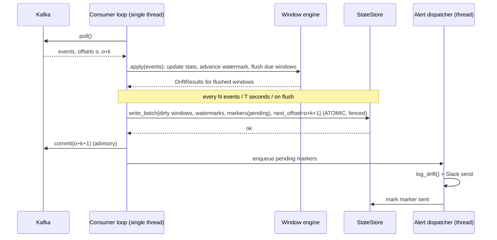

# ADR 0001: etsi-watchdog Streaming Architecture

- **Status:** Accepted / Ratified
- **Date:** 2026-11-20
- **Context:** Watchdog Streaming Task Plan (Kafka drift detection pipeline)
- **Document Reference:** See [docs/WORKFLOW_0.md](../WORKFLOW_0.md) for full context, test matrix, and milestone delivery plan.

---

# PART II — ARCHITECTURE DECISIONS

## 6. Decisions

### D-1 · Streaming statistics (Task 0.1) — amended

**Decision.**
- **PSI:** exact running histogram. `edges = linspace(ref.min(), ref.max()+1e-8, buckets+1)` computed **once** from the reference; counts incremented with `bisect.bisect_right` on a Python list (≈2.1M events/s vs ≈0.43M for scalar `np.searchsorted` **[V]**). Out-of-range values **clamp into the first/last bin**. The batch zero-mass rule (`e == 0 or a == 0 → 0`) is mirrored exactly.
- **KS / Wasserstein:** fixed-capacity reservoir (Algorithm R), default **2,000**, configurable, hard max 10,000. Flush runs `scipy.stats.ks_2samp` / `wasserstein_distance` against a **reference sample subsampled once at boot** (seeded, `REFERENCE_MAX_SAMPLES` = 50,000).
- **Determinism:** reservoir RNG is **SplitMix64** with a single `uint64` state, seeded from `blake2b(base_seed | stream_id | feature | window_start)` and **checkpointed with the reservoir**. Not `numpy` PCG64 (state exceeds 64 bits → msgpack `OverflowError` **[V]**); never Python `hash()` (randomised per process **[V]**). A mid-stream checkpoint/restore reproduced the identical sample **[V]**; throughput ≈1.4M events/s **[V]**.
- **Merge:** every stat implements `merge()`. PSI merge = count addition (exact). Reservoir merge draws the per-side counts from a **hypergeometric** distribution weighted by `n_seen`. Naive concatenation of unequal-size reservoirs is wrong (KS vs union p≈0 **[V]**); hypergeometric merge passes (median p≈0.63, 7% < 0.05 **[V]**).
- **Stat contract:** `update`, `merge(other, rng_seed)`, `finalize(reference, threshold, meta) → DriftResult`, `to_state`, `from_state`, `reset`, `n`.

**Why 2,000 (not the draft's 10,000).** Payload per feature-window is ≈17.6 KB msgpack at 2k vs 201 KB JSON / 78 KB raw at 10k; at 100 streams × 6 features that is ≈48 MB rewritten per checkpoint at 10k **[V]**. Capacity is also a sensitivity knob: for a 0.05σ mean shift the median KS score is 0.93 at n=2,000 and 1.00 at n=10,000 **[V]** — documented, not treated as memory tuning only.

**Parity definition (testable).** Streaming PSI == batch `compute_psi` to `1e-9` when all current values lie in the reference range. Outside it the scores diverge by design (4σ shift: batch 6.65 vs clamp 8.61 **[V]**); the guarantee is then **same drifted/not-drifted classification**. KS/Wasserstein: within a documented error bound, never equality (§8).

**Rejected:** unbounded raw buffer (memory scales with window); research-grade online KS/Wasserstein (no production libraries); sketches (t-digest/KLL) → v2 ticket.
**Revisit when:** alerts depend on p99+ tail shape; multi-instance state merging is required.

### D-2 · Reference model (Task 0.2) — kept

Static reference loaded once from `WATCHDOG_REFERENCE_PATH` (local CSV/Parquet). **No S3/remote in v1** (new dependency + failure modes). Boot validates the artifact against `WATCHDOG_FEATURES` (present, numeric, non-empty) and fails fast. No automatic re-baselining (sustained drift would silently become the new normal); mitigation is a documented runbook: regenerate artifact → restart. Determinism ("same reference + same stream ⇒ same scores") holds because of D-1's seeded, checkpointed RNG.
**Revisit when:** product explicitly requests adaptive baselining and accepts the feedback risk.

### D-3 · State store (Task 0.3) — amended

Redis is the default; RocksDB is an optional backend behind the same `StateStore` ABC. Contract:

```python
get(key) -> Optional[bytes]
get_many(keys) -> Dict[str, bytes]
list_prefix(prefix) -> List[str]
write_batch(puts, deletes, ttl=None, fence=None) -> None   # ATOMIC; raises on failure or fence mismatch
close()
```

Implementations are **thread-safe** (the dispatcher writes `sent` markers). `InMemoryStateStore` (lock + `snapshot()/restore()`) is the M1 backend and the test double.

**Keys** (`stream_id` restricted to `^[A-Za-z0-9._-]{1,128}$`, rejected otherwise — it is untrusted input landing in a key; `|` delimiter dropped):

| Key | Value | TTL |
|---|---|---|
| `wd:v1:{g}:offset:{topic}:{partition}` | int `next_offset` | none |
| `wd:v1:{g}:wm:{stream_id}` | float watermark (epoch s) | none |
| `wd:v1:{g}:win:{stream_id}:{feature}:{start}` | `{schema_version, algo, stat_state}` | `window_size + grace + margin`, refreshed on write |
| `wd:v1:{g}:marker:{stream_id}:{feature}:{algo}:{start}` | `{schema_version, status: pending\|sent, result}` | 24 h from last write |
| `wd:v1:{g}:owner` | lease token | `LEASE_TTL_SECONDS` |

**Serialization:** msgpack with `schema_version` (Task 4.4); never pickle. All stored numbers cast to plain `float`/`int`.
**Redis operations:** `appendonly yes` **and `maxmemory-policy noeviction`** (an LRU policy could silently evict window state). The checkpoint is applied by a Lua script that first verifies the D-5 owner token, so a zombie instance cannot write. If Redis Cluster is ever used, wrap `{g}` in literal braces (hash tag) so a checkpoint's keys share one slot; v1 targets a single Redis. Because offsets are in the same atomic write as state (D-6), even a rollback to an older AOF point is self-consistent — it just replays more Kafka.
**Cost:** one round-trip per checkpoint, not per event.
**Revisit when:** measured state volume/latency hurts, or embedding becomes an ops win.

### D-4 · Message schema (Task 0.4) — kept, parsing rules added

Flat JSON; producer key = `stream_id`:

```json
{"stream_id": "station-007", "event_ts": "2026-08-26T14:00:00Z", "temperature": 23.4, "relativeHumidity": 61.2}
```

`event_ts`: ISO-8601 with `Z`/offset (naive rejected) **or** epoch seconds in `[0, 1e11)`. Python 3.8–3.10 `datetime.fromisoformat` rejects a trailing `Z` and fractions that are not 3 or 6 digits → normalise `Z` → `+00:00` and pad/truncate the fraction to 6 digits. Reserved optional `schema_v`. Validation semantics: D-9.
**Why JSON:** no registry to run (CI stays broker-free), human-debuggable, shortest path to M1. **Revisit when:** external producers appear, schema governance lands, or encoding cost is measurable.

### D-5 · Partitioning and ownership (Task 0.5) — amended

**Invariant:** all events of one `stream_id` go to **one partition** (producer key = `stream_id`) and exactly **one consumer instance** owns the group. Several streams may share a partition; checkpoints cover all windows of all streams on the assigned partitions. (The draft's "one partition per stream" was stronger than correctness needs and had no mechanism — key hashing cannot guarantee 1:1.)
**Single-owner guard:** at boot the service takes a Redis lease `SET owner <token> NX PX <ttl>`; the processing loop renews it whenever more than `ttl/3` has elapsed (renew only if the token matches); loss of the lease ⇒ stop immediately without writing. Boot waits up to `LEASE_TTL_SECONDS` for a dead owner's lease to expire, then fails with a clear message. Graceful shutdown releases it. v1's safety rests on "one instance"; this enforces it.
**Not in v1:** rebalance safety across multiple instances (Task 3.4, ticketed). **In v1:** `on_assign` seeks from stored offsets (required by D-6) and `on_revoke` triggers a checkpoint.
**Designed-in scale-out:** shard streams across partitions by key, run multiple consumers; state keys already embed `stream_id`, so ownership transfer needs no data migration.
**Revisit when:** aggregate load approaches single-consumer capacity.

### D-6 · Checkpoint, offsets and replay — new (the fault-tolerance core)

"Persist state, then commit offset" alone is **not** enough: a crash between the two replays events already contained in the checkpoint and double-counts them. Therefore:

1. A checkpoint is **one atomic `write_batch`** containing: dirty window states, per-stream watermarks, flushed-window markers, per-partition `next_offset`; flushed windows' state keys are deleted in the same batch.
2. **The state store is the source of truth for position.** On `on_assign`, seek to the stored `next_offset`; the Kafka commit is advisory (lag tooling, group continuity). No stored offset ⇒ fall back to committed/`earliest` and print that state was absent. If Kafka reports the stored offset out of range (retention expired) ⇒ `earliest`, `offset_resets += 1`, loud warning (state and log no longer line up).
3. Triggers: every `CHECKPOINT_EVENTS` (1,000) **or** `CHECKPOINT_SECONDS` (5), on every window flush, on `on_revoke`, on shutdown.
4. **Dispatch only after the durable write.** Nothing is committed or alerted without a checkpoint. If the store fails: `pause()`, retry with backoff for 60 s, then exit non-zero.



| Crash point | On restart | Outcome |
|---|---|---|
| after `apply`, before `write_batch` | seek to older stored offset, rebuild | no loss, no double count |
| after `write_batch`, before Kafka commit | **seek to stored `next_offset`** (ignore stale commit) | no double count |
| after commit, before dispatch | `pending` markers re-dispatched | alert delivered once |
| after Slack ack, before `sent` mark | `pending` re-dispatched | **one possible duplicate**, same idempotency key |
| *reversed order (commit, then persist)* | events `o..o+k` gone | silent loss — **never do this** |

**Rehydration (Task 3.3)** = load all `win:*`/`wm:*` → sweep `flush_due` (idempotent safety net; in the event-time model all due windows were already flushed in-line) → re-dispatch `pending` markers → seek from stored offsets.
**Shutdown (SIGTERM):** stop polling → finish batch → final checkpoint → commit → drain dispatcher (≤ 10 s) → release lease → exit 0.
**Never reorder.** Amend only with a new crash matrix.

### D-7 · Windows, time, lateness (Tasks 2.1–2.3) — new

- **Event time** = `event_ts`. Tumbling windows are **epoch-aligned**: `start = floor(ts/size)*size`, identical across restarts and replays.
- **Per-stream watermark** = max accepted `event_ts` (monotonic, checkpointed). A window flushes when `watermark ≥ start + size + grace` (`GRACE_SECONDS` = 30). Several windows per `(stream, feature)` may be open at once.
- **Late** = event whose window already flushed (`start + size + grace ≤ watermark` before this event). **Dropped and counted** (`late_dropped`). One policy, no late bucket in v1.
- **No wall-clock flush in v1**: a silent stream's last window stays open (reported as `streams_idle`). Optional `max_idle_flush_seconds` (default off) because it introduces nondeterminism. Tests send a trailing event to close the final window.
- `min_events_per_window` = 50 (mirrors the batch `<50` warning): smaller windows emit no result, only a counter.
- **Deferred:** `window_size_events` (key scheme is time-based).
- **Hopping (M3):** sub-buckets of `gcd(size, hop)`, merged through the stat `merge()`; flush at `watermark ≥ s + W + grace`; buckets retired once every window containing them is flushed; idempotency key uses the window start. **Timeboxed spike before any estimate**; fallback if the spike justifies it for small `W/H`: multi-assign each event to its overlapping windows. Never gates M1/M2.
- Flushed windows are deleted; markers keep a 24 h TTL.
**Revisit when:** a consumer needs processing-time or count-based windows.

### D-8 · Alert semantics and delivery — new

- **Idempotency key** = `(stream_id, feature, window_start, algorithm)`; a flush writes its marker and `DriftResult` inside the checkpoint, so a replayed flush finds the marker and does not re-emit.
- **Delivery: at-least-once** with the one residual duplicate in D-6. Exactly-once to Slack is not achievable.
- `log_drift` for **every** flushed result (as `Monitor.watch` does); Slack only when `is_drifted`. CSV only (JSON mode is O(n) per write), path with a directory component. Stream identity is encoded as `feature=f"{stream_id}/{feature}"`; `additional_context` carries `stream_id`, `window_start`, `window_end`, `n_events`, idempotency key. A backward-compatible `extra=` kwarg on `log_drift` is a separate ticket.
- Sends run on **one dispatcher thread** behind a bounded queue (1,000); the poll loop never calls Slack, so `max.poll.interval.ms` is safe. Failure ⇒ exponential backoff (1 s → 30 s, 5 tries) ⇒ `alerts_failed`; marker stays `pending`; pending markers are re-dispatched every 60 s and on boot.
- Stats/state objects are never shared across threads; the loop hands over immutable `DriftResult`s.
**Revisit when:** a downstream sink offers idempotent delivery.

### D-9 · Validation and poison messages (Task 3.5) — new

- **Message level** — unparseable JSON, missing/invalid `stream_id`, bad `event_ts`, `ts_future`, `stream_cap`: drop, count by reason, **offset still advances** (a poison message must never wedge the partition).
- **Feature level** — missing, non-numeric (bool excluded), NaN, ±inf: skip *that feature for that event* (mirrors batch `dropna()`), count by reason.
- **Fail fast only at boot** (reference, config, Redis, Slack auth, `LOG_PATH`), never on data.
- **Watermark-poisoning guard:** one far-future `event_ts` would advance a stream's watermark, flush every open window early, and turn all later genuine events "late". Events with `event_ts > wall_clock + MAX_FUTURE_SKEW_SECONDS` (3600; `0` disables) are rejected as `ts_future` and never touch the watermark. Known edge: this reads wall-clock time, so an event rejected before a crash could be accepted on replay once it ages into range — documented, not engineered away.
- `MAX_STREAMS` (1,000): new `stream_id`s beyond the cap are dropped and counted — total state is `streams × features × reservoir`, not "constant".
- DLQ topic: v2.

### D-10 · Registry integration and thresholds (Task 1.3) — new

- Register `psi_streaming`, `ks_streaming`, `wasserstein_streaming` through the **existing** `register_drift_algorithm` (no parallel registry). Each registered callable is a **DataFrame-signature adapter** (replays `current_df` through the incremental object, then `finalize`), so `DriftCheck`, `Monitor` and the CLI accept it and the adapter doubles as the parity-test harness. The service reads the incremental class from the same entry (`.stat_factory`, `.default_threshold`).
- Registration happens when `etsi.watchdog.streaming` is imported, **not** at `etsi.watchdog` import (the registry prints on each registration; batch users see no change).
- `DriftResult`: `method` = `"psi"|"ks"|"wasserstein"` (unchanged strings); `sample_size` = events in the window; `details` keeps the batch keys (PSI: `bins`, `expected_percents`, `actual_percents`, `psi_per_bin`; KS: `ks_statistic`, `p_value`; W: `wasserstein_distance`) and adds `window_start`, `window_end`, `n_events`, and for sketches `n_seen`, `reservoir_size`, `approximation`, `dkw_epsilon_95`.
- **Defaults:** PSI 0.2; **KS 0.95** (not 0.2: no-drift false-alert rate 82.6% at 0.2, 7.6% at 0.95, 1.0% at 0.99 **[V]**); **Wasserstein threshold required** (score is in raw feature units).

### D-11 · Configuration, entrypoint, packaging (Tasks 5.1, 5.2, 6.1, 6.3) — new

Env-driven `StreamingConfig.from_env()` with `validate()`. Slack keeps `SLACK_BOT_TOKEN`/`SLACK_CHANNEL`; all new variables use `WATCHDOG_`:

| Variable | Default |
|---|---|
| `KAFKA_BOOTSTRAP`, `TOPIC` (required), `GROUP` | `etsi-watchdog` |
| `REFERENCE_PATH`, `FEATURES` (comma list) | required |
| `ALGORITHM`, `THRESHOLD`, `PSI_BUCKETS` | `psi_streaming`, per-algo default, 10 |
| `WINDOW_TYPE`, `WINDOW_SECONDS`, `HOP_SECONDS` | `tumbling`, required, – |
| `GRACE_SECONDS`, `MIN_EVENTS` | 30, 50 |
| `RESERVOIR_SIZE`, `REFERENCE_MAX_SAMPLES`, `SEED` | 2000 (max 10000), 50000, 0 |
| `STATE_BACKEND`, `STATE_URL` | `memory`, – (`redis://`/`rediss://`) |
| `CHECKPOINT_EVENTS`, `CHECKPOINT_SECONDS` | 1000, 5 |
| `LEASE_TTL_SECONDS` | 30 (10 in tests) |
| `MAX_STREAMS`, `MAX_FUTURE_SKEW_SECONDS` | 1000, 3600 |
| `LOG_PATH`, `HEALTH_SECONDS` | must contain a directory, 60 |

Boot fails fast on: missing required vars; feature absent or non-numeric; empty reference; reservoir > 10,000; hopping without `hop` or `window % gcd ≠ 0`; Wasserstein without threshold; `LOG_PATH` without a directory.
**Entry:** `python -m etsi.watchdog.streaming` + console script `etsi-watchdog-stream` (additive `[project.scripts]`; `run_cli()` untouched).
**Extras:** `streaming = [confluent-kafka, redis, msgpack]`; `streaming-rocksdb = [rocksdict]` (native build, separate). All imports lazy with an actionable `ImportError`. Dependency floors on Python 3.8 verified in CI before any code (Gate).
**Docker:** `python:3.11-slim`, non-root, full core deps (R9). **Security:** Redis auth/TLS via URL; no secrets in compose files; no pickle; stream-id charset rule.

### D-12 · Concurrency, structure, observability — new

- **One** processing thread (consume → validate → update → flush → checkpoint → lease renewal); **one** dispatcher thread. No asyncio.
- Kafka I/O behind an `EventSource` ABC (`start`, `poll`, `commit`, `pause/resume`, `close`) so windows/stats/checkpoint run broker-free in unit tests; `FakeEventSource` replays a message list and tracks committed offsets.
- **Metrics:** plain counters + periodic `print` health line: `events_in`, `events_rejected{reason}`, `features_skipped{reason}`, `late_dropped`, `windows_flushed`, `windows_skipped_insufficient`, `checkpoints`, `checkpoint_ms_last`, `checkpoint_bytes_last`, `alerts_sent/failed/pending`, `offset_resets`, `streams_active`, `streams_idle`, `lag_events`. Prometheus is v2.
- **Tests:** a unit-level **crash matrix** (fault hooks after each D-6 step, `InMemoryStateStore` + `FakeEventSource`) runs **before** Redis and again on Redis, in addition to Task 7.3's Docker kill-and-restart.

## 7. How the decisions compose, and the package layout

```
Producers ──key=stream_id──▶ Kafka (stream → one partition)          single owner (D-5 lease)
   └▶ EventSource ─▶ validate/dispatch (D-4, D-9)
        └▶ window engine: epoch-aligned, watermark, grace (D-7)
             └▶ stats: PSI histogram | seeded reservoir (D-1) vs static reference (D-2)
                  └▶ flush → DriftResult (D-10)
                       └▶ ATOMIC checkpoint {state, watermarks, markers, offsets} → StateStore (D-3, D-6)
                            └▶ Kafka commit (advisory) → dispatcher thread → log_drift + SlackNotifier → mark sent (D-8)
```

Target package layout (all new, additive): `etsi/watchdog/streaming/{__init__, __main__, config, events, metrics, source, kafka_consumer, checkpoint, alerts, streaming_monitor}.py`, `stats/{base, rng, reference, psi_incremental, reservoir, ks_streaming, wasserstein_streaming, adapters}.py`, `windows/{keys, engine, tumbling, hopping}.py`, `state/{base, codec, memory_store, redis_store, rocksdb_store, lease}.py`; tests in `tests/streaming/`.

## 8. Error characteristics to document (Task 1.2)

- **KS (reservoir):** with 95% confidence the KS *statistic* differs from the full-window value by at most ε_cur + ε_ref, ε = √(ln(2/0.05)/(2k)): **0.030** for k = 2,000, **0.0136** for k = 10,000, ≈ **0.006** for the 50,000-sample reference. The p-value is computed from the reservoir size, not `n_seen`, so it is more conservative than a full-window KS.
- **Wasserstein:** no distribution-free bound; bounded empirically in tests (relative error on bounded features).
- **PSI:** exact in-range; clamped outside (D-1).
- **No-drift alert rate** at the KS default 0.95 is ≈5–8% per window by construction **[V: 7.6%]** — documented, not "fixed".

## 9. Implications for Workstreams 1–8 and milestone sequencing

| WS | Change from the Plan as written |
|---|---|
| 1 | Stat contract with `merge`/`to_state`/`from_state`; PSI clamp + zero-rule; SplitMix64 reservoir; adapters; parity tests per D-1; KS default 0.95 |
| 2 | Epoch alignment, watermark, grace, drop-late; hopping = timeboxed spike, then `merge()`; hopping tested against exact recompute |
| 3 | `EventSource` seam; **seek-from-state in `on_assign` is v1** (not 3.4); poison policy; `auto.offset.reset=earliest`; owner lease |
| 4 | Atomic fenced `write_batch`; `get_many`; marker TTL; RocksDB manual TTL sweep; Kafka retention note |
| 5 | `StreamingMonitor` = loop + checkpoint + dispatcher; Slack via dispatcher; `log_drift` CSV with a directory |
| 6 | `python:3.11-slim`; Redis `appendonly yes` + `noeviction`; single replica; topic-init; KRaft flagged as the simpler alternative the Plan already mentions |
| 7 | Crash-matrix unit tests before 7.3; 7.2 uses the parity definition and DKW coverage; 7.3 also asserts replay determinism; 7.4 reports checkpoint bytes/latency vs reservoir size |
| 8 | this document → `docs/WORKFLOW_0.md`; `examples/streaming_demo.py` (CSV-replay Kafka producer) + `tests/streaming/synth.py` (seeded `level_shift`/`gradual_drift`/`variance_burst`, finite clamped values, monotonic `event_ts`) replace the generator package |

**Milestones (Plan M1–M4, with one refinement):** M1 = tumbling + in-memory store + PSI + a **real `KafkaEventSource`** ("raw events → drift alert, end to end"; M1 *tests* stay broker-free) · M2 = Redis, atomic checkpoint, rehydration, lease, crash matrix, Task 7.3 · M3 = KS/Wasserstein, hopping, RocksDB · M4 = Docker/compose, benchmark, docs. Hopping never gates M1/M2.

