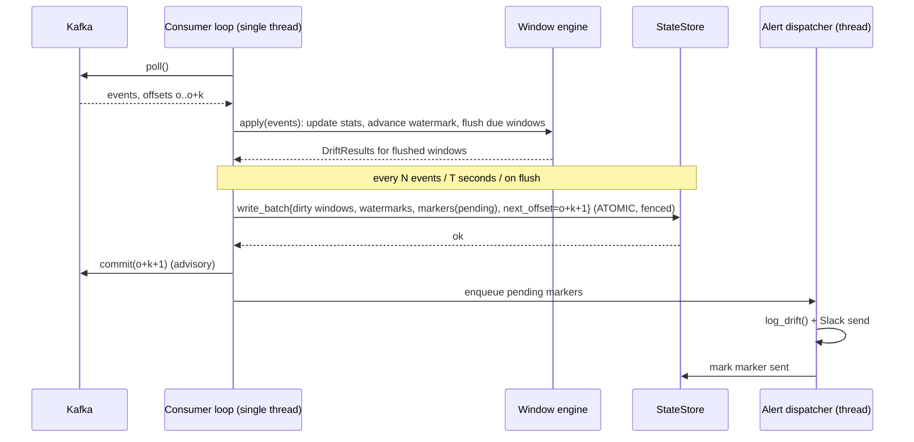

# ADR 0001: etsi-watchdog Streaming Architecture

- **Status:** Accepted / Ratified (2026-11-20)
- **Context:** Watchdog Streaming (Kafka) — Workstream 0 (Tasks 0.1–0.5, 2.3, 3.2)
- **Full Specification:** See [docs/WORKFLOW_0.md](../WORKFLOW_0.md) (authoritative self-contained ADR, contracts, test matrix, and delivery plan).

## Core Architecture Decisions Summary

| ID | Task | Decision |
|---|---|---|
| **D-1** | 0.1 Streaming stats | **PSI:** exact running histogram (`bisect.bisect_right` on Python list, fixed reference edges, clamp out-of-range, batch zero-mass rule). **KS / Wasserstein:** Algorithm R bounded reservoir (default `2,000`, hard max `10,000`) with checkpointed `SplitMix64` PRNG (`blake2b` seeded) and hypergeometric `merge()`. Quantile sketches (`#52`) deferred to v2. |
| **D-2** | 0.2 Reference model | Static reference loaded once at boot from `WATCHDOG_REFERENCE_PATH` (local CSV/Parquet), validated against `WATCHDOG_FEATURES`; no automatic re-baselining and no S3/remote loader in v1. |
| **D-3** | 0.3 State store | Abstract `StateStore` with atomic fenced `write_batch`; `InMemoryStateStore` for M1/tests, `RedisStateStore` (`appendonly yes`, `maxmemory-policy noeviction`, Lua owner-lease fencing) as v1 durable default, optional `RocksDB` (`#66`) behind the same ABC. Msgpack with `schema_version=1`. |
| **D-4** | 0.4 Message schema | Flat UTF-8 JSON with `stream_id`, ISO-8601 UTC / epoch `event_ts`, and numeric feature values; producer key = `stream_id`. Avro + Schema Registry (`#72`) deferred to v2. |
| **D-5** | 0.5 Partitioning & ownership | Producer key = `stream_id` (one stream → one partition; multiple streams may share a partition). Single consumer instance guarded by mandatory Redis owner lease (`LEASE_TTL_SECONDS`). Multi-partition rebalance safety (`#51`) deferred to v2. |
| **D-6** | 3.2 Checkpoint-then-commit | Single atomic `write_batch` persists `{dirty windows, watermarks, pending markers, next_offset}` and deletes flushed windows **before** advisory Kafka commit and alert dispatch. `on_assign` seeks from stored `next_offset`. |
| **D-7** | 2.3 Windows & lateness | Event-time epoch-aligned tumbling windows (`GRACE_SECONDS=30`), per-stream monotonic watermark, late events beyond grace dropped and counted (`late_dropped`). Hopping (`#65`) and count-based (`#53`) windows handled separately. |
| **D-8** | Alert delivery | At-least-once via dedicated `AlertDispatcher` thread (`log_drift` CSV with directory path + `SlackNotifier` on drift), idempotency key `(stream_id, feature, window_start, algo)`. |
| **D-9** | 3.5 Poison messages | Message-level rejects and `ts_future` skew guard drop + count by reason and advance offset; feature-level invalid values skip only that feature. Never crash-loop on bad data. |
| **D-10** | 1.3 Registry | `psi_streaming`, `ks_streaming` (default threshold `0.95`), `wasserstein_streaming` (threshold required) registered via `register_drift_algorithm()` only when `etsi.watchdog.streaming` is imported. |
| **D-11** | 5.1, 5.2, 6.1, 6.3 Config & packaging | Env-driven `StreamingConfig.from_env()` (`WATCHDOG_*`, Slack `SLACK_BOT_TOKEN`/`SLACK_CHANNEL`); lazy `[streaming]` (`confluent-kafka>=2.0.0`, `redis>=5.0.0`, `msgpack>=1.0.0`) and `[streaming-rocksdb]` extras; `python:3.11-slim` Docker image; `python -m etsi.watchdog.streaming` + `etsi-watchdog-stream` (`#67`). |
| **D-12** | 3.5, 7.3 Runtime & observability | Single processing thread + single `AlertDispatcher` thread (no asyncio); `EventSource` ABC (`FakeEventSource` for broker-free tests); counter metrics + periodic `print` health line (Prometheus `#71` deferred to v2); unit-level crash matrix before Docker IT (`#70`). |

## D-6 Checkpoint-Then-Commit Sequence

For full contracts, composition, error bounds, acceptance criteria, and tracked issues (`#49–#56`, `#65–#72`), see [docs/WORKFLOW_0.md](../WORKFLOW_0.md).
